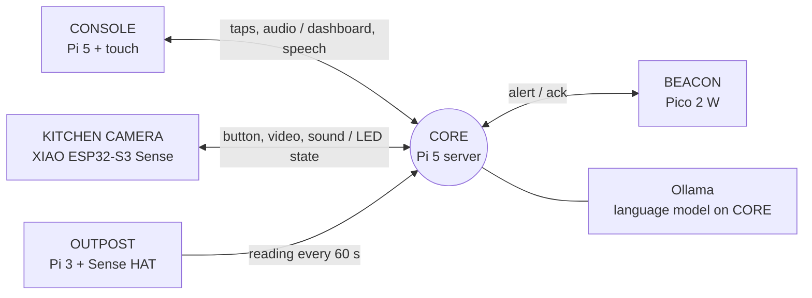

# J.A.R.V.I.S. House System

A five-node home assistant: system design, enclosure models, wiring, and the software for
every node. See [SETUP.md](SETUP.md) to install it.

Open `index.html` for the full drawing set (system map, dinner sequence, weather-station
cross-section, wiring, parts list).

## Nodes

| Callsign | Board | Where | Job |
|---|---|---|---|
| CORE | Raspberry Pi 5 + NVMe, USB mic and speaker | near the router | MQTT broker, rules, local language model (Ollama), speech in and out, weather history, dashboard |
| CONSOLE | Raspberry Pi 5 + 7" touchscreen | desk | main input: touch, wake word, mic, speaker |
| OUTPOST | Raspberry Pi 3 + Sense HAT | outside wall | temperature, humidity, pressure every 60 s |
| KITCHEN CAMERA | Seeed XIAO ESP32-S3 Sense | kitchen | live camera and microphone for the dashboard, and the dinner button |
| BEACON | Raspberry Pi Pico 2 W | bedroom / workshop | glows and chimes for dinner, button replies "on my way" |



## MQTT topics

| Topic | From → To | Payload |
|---|---|---|
| `jarvis/outpost/weather` | OUTPOST → CORE | `{"temp_c":8.4,"humidity":71,"pressure_hpa":1009.2}` |
| `jarvis/kitchen/dinner` | KITCHEN CAMERA → CORE | `pressed` |
| `jarvis/kitchen/led` | CORE → KITCHEN CAMERA | `off` / `blink` / `solid` |
| `jarvis/beacon/alert` | CORE → BEACON | `dinner` / `clear` |
| `jarvis/beacon/ack` | BEACON → CORE | `pressed` |
| `jarvis/console/say` | CORE → CONSOLE | text to speak and show |
| `jarvis/+/status` | every node → CORE | `online` / `offline` (last-will) |

## Enclosures (`cases/`)

Parametric OpenSCAD sources plus print-ready STLs in `cases/stl/`. Every STL is a
watertight single body. Dimensions come from published board drawings and have **not been
test-fitted**: print the first 4 mm of each base as a fit check.

| File | Parts | Material | Notes |
|---|---|---|---|
| `core_server_case.scad` | base, lid | PETG | Room for Active Cooler + M.2 HAT+. No supports. |
| `console_stand.scad` | frame, shroud | PETG | Defaults fit the Raspberry Pi Touch Display 2 (7"). Set `disp_w/h/t` for other screens. Frame needs supports under the back ledge. |
| `weather_station.scad` | base, louvre ×6, spider, drum, lid, sunshade | white ASA or PETG | Needs a 205 × 200 mm bed. 4 perimeters, 40% infill on drum and lid. |
| `kitchen_button.scad` | body, base | PETG | `btn_hole = 28` for a 30 mm arcade button, 24 for the 24 mm type. |
| `beacon_pico.scad` | cup, plate, cap | PETG, cap in natural/white | Cap's 1 mm top is the diffuser. |

Export a part:

```sh
openscad -o out.stl -D 'part="drum"' cases/weather_station.scad
```

Use `part="assembly"` to preview a whole enclosure (and `"section"` for the station).

### Weather station assembly

Bottom to top on three M4 × 180 mm threaded rods: base → 6 louvres → spider (Sense HAT
hangs under it on 15 mm standoffs) → drum (Pi 3 inside) → lid → sunshade → wing nuts.

- The rods run outside the sealed drum, so nothing pierces the seal.
- 2.5 mm silicone cord in the drum's rim groove; PG7 cable gland in one side boss, M12
  breather vent in the other.
- A 40-way male-to-female GPIO ribbon links the Pi to the Sense HAT through the slot in
  the drum floor. Seal the slot with neutral-cure silicone.
- Conformal-coat the Sense HAT (mask the sensor chips), line the louvres with insect mesh,
  keep the LED matrix off so it does not warm the temperature sensor.

## Wiring

| Node | Connection |
|---|---|
| KITCHEN CAMERA | D1 (GPIO 2) → switch → GND (internal pull-up) |
| KITCHEN CAMERA | D2 (GPIO 3) → button LED + ; LED − → GND (100 Ω in series if the LED has no resistor) |
| BEACON | VBUS (pin 40) → ring 5 V ; GND (pin 38) → ring GND |
| BEACON | GP2 (pin 4) → 330 Ω → ring DIN |
| BEACON | GP15 (pin 20) → piezo + ; GP14 (pin 19) → button → GND |

## Build order

1. CORE: OS, fixed IP, MQTT broker.
2. KITCHEN CAMERA + BEACON on a breadboard, talking through CORE.
3. OUTPOST indoors for a few days, then outside.
4. CONSOLE: kiosk dashboard, then voice.
5. Print and box up. Hose-test the station before the Pi goes in.
