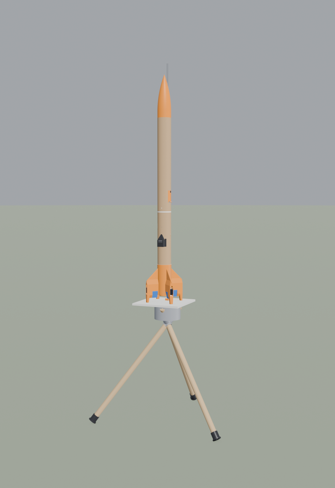
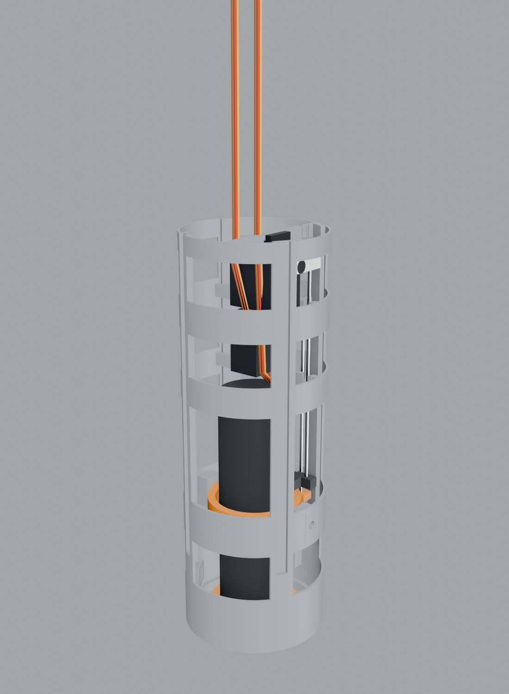
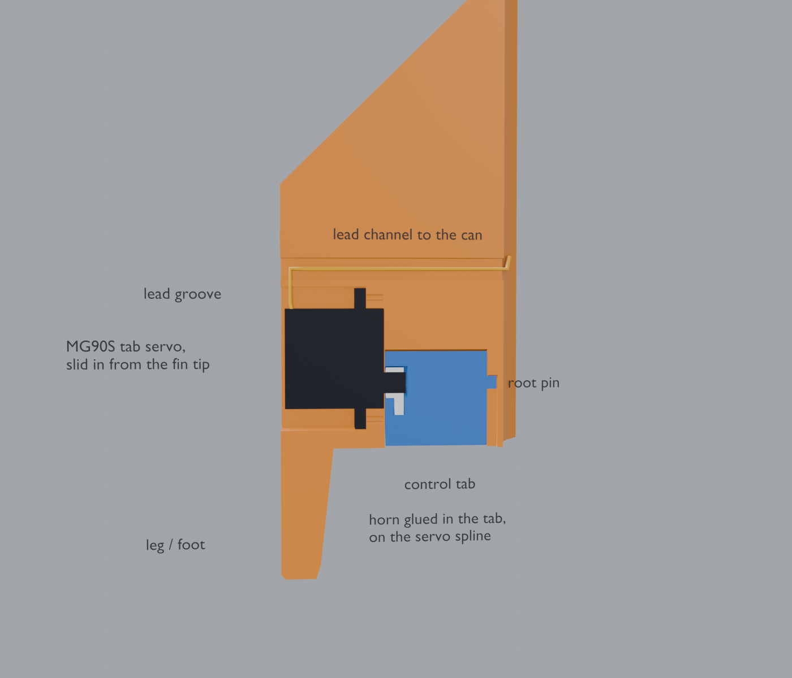
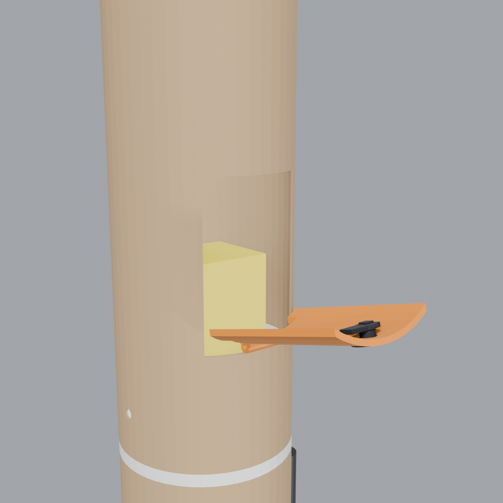
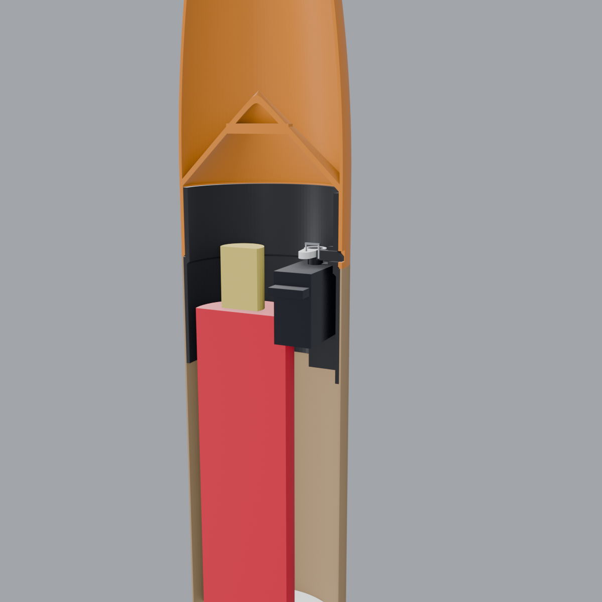

# KESTREL-2: a thrust-vector-controlled model rocket with four steerable fins

A reusable, 3D-printed, ~0.9 m model rocket that **steers its motor** (two-axis thrust vector control) and its
**four fin tabs** (roll, pitch and yaw; each tab's servo sits inside the thick bottom band of its fin and turns it
directly),
**stands up on its own four fins**, releases its parachute **at apogee**
with a servo latch under the nose cone (no pyrotechnics), carries a **payload of up to 50 g** behind a lockable
door, films the flight with a downward-looking camera, and logs IMU, barometer and GPS data on a **custom
flight-computer PCB** built around a Raspberry Pi Pico 2 W. It comes with its own launch pad. **No soldering
anywhere**: the PCB comes assembled from JLCPCB and everything else plugs, screws or glues together. Estimated
build cost **≈ £312** (motors extra).

<p>




</p>
<p>




</p>

**Simulated launch video** (ground camera, onboard camera, live telemetry bottom left, graphs below; every seed is a
different flight): [`kestrel2_flight_seed7.mp4`](sim/results/video/kestrel2_flight_seed7.mp4) (4.9 m/s wind, 20 g
payload). Make another with `python3 sim/video/make_flight_video.py --seed N`.

| | |
|---|---|
| Parts | **3**: bottom (fin can + TVC module + camera + flight computer + battery), middle (payload bay with door · wall · parachute bay · release latch at the top), nose cone |
| Length / diameter / fin span | 903 mm (929 mm standing on its fin feet) / 56.3 mm (Estes BT-70) / 159 mm |
| Lift-off mass | 825 g with a TSP E20 and 25 g of payload (761 g without motor) |
| Motors | 24 mm TSP **E20-0** (mission), TSP D20-0 (first hops) |
| Apogee (simulated, E20) | **57 m** nominal with 25 g of payload; Monte Carlo mean 62 m, 90 % of flights 47–79 m |
| Stability | +0.84 to +0.97 calibres at lift-off (empty to full payload bay, with 33 g of nose ballast): still stable if all steering fails |
| TVC | 2-axis gimbal, ±6° vector limit, 2 × MG90S, 500 Hz control loop |
| Fins | 4 × normal 4 mm fins with a half-round leading edge; only the bottom band (45 mm next to the tail) is 15 mm thick, joined by a smooth 15° wedge, and holds the tab hinge, the tab servo (in a pocket open at the tip) and its lead channel; band, tabs and legs taper to thin trailing edges below the tail |
| Fin tabs | 4 trailing-edge tabs, ±15°, each turned directly by an MG90S inside its fin (servo shaft = hinge line: no pods, pushrods or hinge pins); hold roll in boost and coast, share pitch/yaw with the TVC in the burn, steer alone in the coast |
| Recovery | 36 in parachute, spring ejection, servo-released snap-in latch, 4.9 m/s landing |
| Payload | 130 mm bay, 32 × 50 mm hinged door with a quarter-turn lock, 4 × M3 mounting holes, up to 50 g |
| Flight computer | Pico 2 W + LSM6DSO IMU + BMP580 baro + ATGM336H GPS + 16 MB log, 4-layer 40 × 82 mm PCB, 7 servo ports |
| Camera | SQ12-class 23 mm cube in an external pod, lens looking down the body |
| Launch pad | printed hub, 3 dowel legs, 1 m (or 1.5 m) × 6 mm rod, 0–15° tilt, 200 mm tile the rocket stands on |

## How it was verified

- **Simulation with the real flight code in the loop.** A 6-DOF simulator, checked against RocketPy (every
  quantity within 0.3 %), flies the actual C++ flight software 500 times a second, including the fin-tab mixer.
  **Scenario and fault suite: 40 of 40 graded cases pass** (plus 3 informational cases).
  **1000-flight Monte Carlo: 100 % success** (after two fixes it found in the servos-in-the-fins version: see the
  report). A stress Monte Carlo with about twice the error spreads and wind up to 9 m/s: 99.2 % meet every
  normal-flight criterion and 100 % recover safely. → [docs/SIMULATION_REPORT.md](docs/SIMULATION_REPORT.md)
- **CAD checked automatically on every run.** All 27 printed parts are watertight, single-body and fit a
  220 × 220 × 250 mm bed, and an overhang check confirms they print as exported without support material (three
  marked parts excepted). Exact-geometry interference checks cover 1326 part pairs, plus sweeps of every mechanism
  through its full travel: the gimbal in 24 directions at 7°, all four tabs at ±17°, the payload door through
  0–100° and the release latch. All come back clean. Masses and positions feed the simulator, the av-bay is
  generated from the PCB's KiCad layout, and every number the firmware and simulator take from `design.json`
  (linkage ratios, tab geometry, IMU position, camera-pod size) is checked against the CAD.
- **PCB**: schematic checked pin-for-pin against the circuit source, DRC 0 violations, all 65 nets routed, gerbers
  re-read by an independent viewer. → [docs/PCB.md](docs/PCB.md)
- **Firmware** (v2.02): 376,034 flight-core checks, 127 firmware-logic checks, a 0-warning cross-compile and a
  ready-to-flash UF2. → [docs/FIRMWARE.md](docs/FIRMWARE.md)

Two honest gaps against what we agreed:

- **Apogee**: I estimated ~123 m on the E20 when we chose the motor. The finished rocket is heavier (825 g, not
  ~650 g), and the E20 is rated at 36 Ns, not the 40 Ns of its test curve, so it reaches 57 m (about 71 m if the
  motors match their curve). Putting the tab servos inside the fins accounts for about 20 m of the drop (the 2 mm
  fin version with servo pods reached 77 m): the 15 mm servo band puts about 50 g more at the tail, which needs
  33 g of nose ballast to keep the rocket stable, and the extra weight needs a 36 in parachute for gentle
  landings. The details, with what-if numbers, are in the simulation report, section 3.
- **Budget**: ≈ £312 against the ~£270 we aimed for, because of the four extra servos, the larger 36 in parachute,
  the ejection spring that only comes in a pack of 10, and about £11 of extras for the servos-in-the-fins design. → [docs/BOM.md](docs/BOM.md)

Real flights then confirm what models cannot; [docs/TEST_PLAN.md](docs/TEST_PLAN.md) takes you from the bench to
the first E20 flight in steps.

## Build it

1. **Order the PCB** (1–3 weeks): [docs/PCB.md → Ordering from JLCPCB](docs/PCB.md#ordering-from-jlcpcb)
2. **Buy the rest**: [docs/BOM.md](docs/BOM.md)
3. **Print and assemble**: [docs/BUILD_GUIDE.md](docs/BUILD_GUIDE.md)
4. **Flash and set up**: drag `firmware/pico/kestrel_fc.uf2` onto the Pico, then `calaxes`, `dirtest`, `tabtest`,
   `tvctest`, `fintest`
5. **Test**: [docs/TEST_PLAN.md](docs/TEST_PLAN.md) → **fly**: [docs/PREFLIGHT_CHECKLIST.md](docs/PREFLIGHT_CHECKLIST.md)
6. **Read first**: [docs/SAFETY_AND_LEGAL.md](docs/SAFETY_AND_LEGAL.md) (UKRA/BMFA, CAA, motors, LiPo, wind limits)

## What's where

```
design.json              master parameters: airframe, fins + tabs, TVC, payload, recovery, every component's mass/position
cad/                     Blender + manifold3d parametric model
  kestrel_cad.py           blender -b -P cad/kestrel_cad.py -- [--no-render] [--fast] [--view=NAME]
  kestrel.blend            scene 1: complete rocket + the same rocket cut open + every part laid out with its name;
                           scenes 2-7: exploded view, cut-aways, door open, tabs deflected, fin cut open, on the launch pad
  kestrel_tvc_module.blend the TVC module on its own (its two servo leads come out of the top) + assembly steps
  kestrel_parachute_open.blend  the rocket descending under its open parachute
  stl/                     27 print-ready STLs + check_report.md
  renders/                 the images above
  interference_report.md   part pairs and mechanism sweeps
pcb/                     KiCad 7 project, circuit-as-code, autorouter, production files for JLCPCB
  kestrel_fc.kicad_pro/.kicad_sch/.kicad_pcb, kestrel_fc_schematic.pdf
  production/              gerbers zip, BOM + pick-and-place CSVs, assembly drawing
firmware/
  core/                    flight core (estimation, TVC, fin-tab mixer, state machine) + unit tests
  pico/                    Pico 2 W application, drivers, host tests; kestrel_fc.uf2 = ready to flash
  sil/                     simulator bridge (software-in-the-loop)
  tools/                   kestrel_link.py (USB shell, log download, plots), gen_motor_db.py
sim/                     6-DOF simulator, scenarios, Monte Carlo, RocketPy validation, results/
  video/                   launch-video pipeline (simulation → Blender → telemetry + graphs → MP4)
docs/                    shopping list, build guide, PCB, firmware, test plan, checklist, safety, simulation report
```

## Change it

Everything is parametric and connected: edit `design.json` (or the PCB layout in `pcb/circuit.py`), then
re-run the chain. The CAD script stops with a message if `design.json` and the CAD/PCB disagree.

```bash
blender -b -P cad/kestrel_cad.py -- --no-render && python3 cad/check_parts.py && python3 cad/mass_properties.py
```

```bash
python3 firmware/tools/gen_motor_db.py && cmake --build firmware/build-host && (cd firmware/build-host && ctest)
```

```bash
cd sim && python3 scenarios.py && python3 montecarlo.py && python3 plot_montecarlo.py
```

Tools: Blender 4.0, KiCad 7, Python 3 (numpy, matplotlib, pillow, trimesh, manifold3d, rocketpy), ffmpeg,
Raspberry Pi Pico SDK 2.1, arm-none-eabi-gcc.
