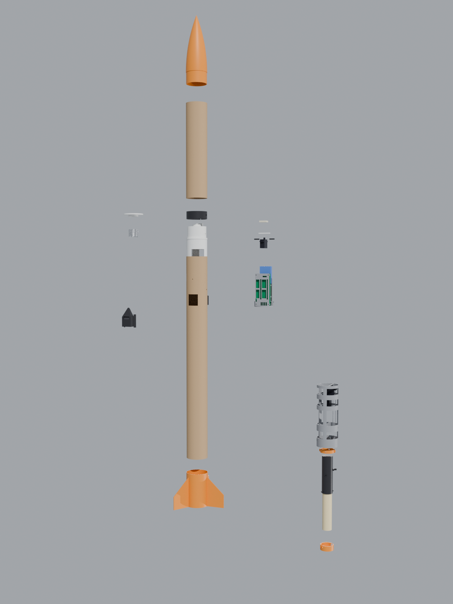
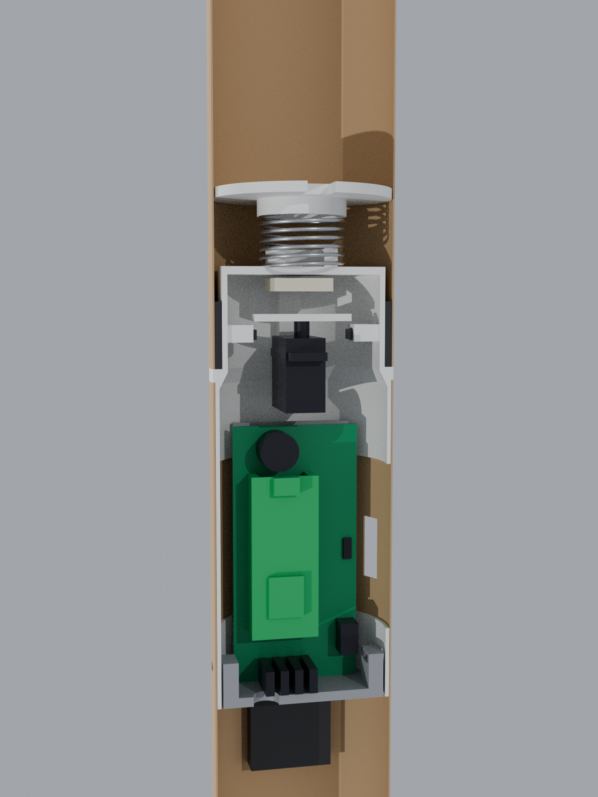
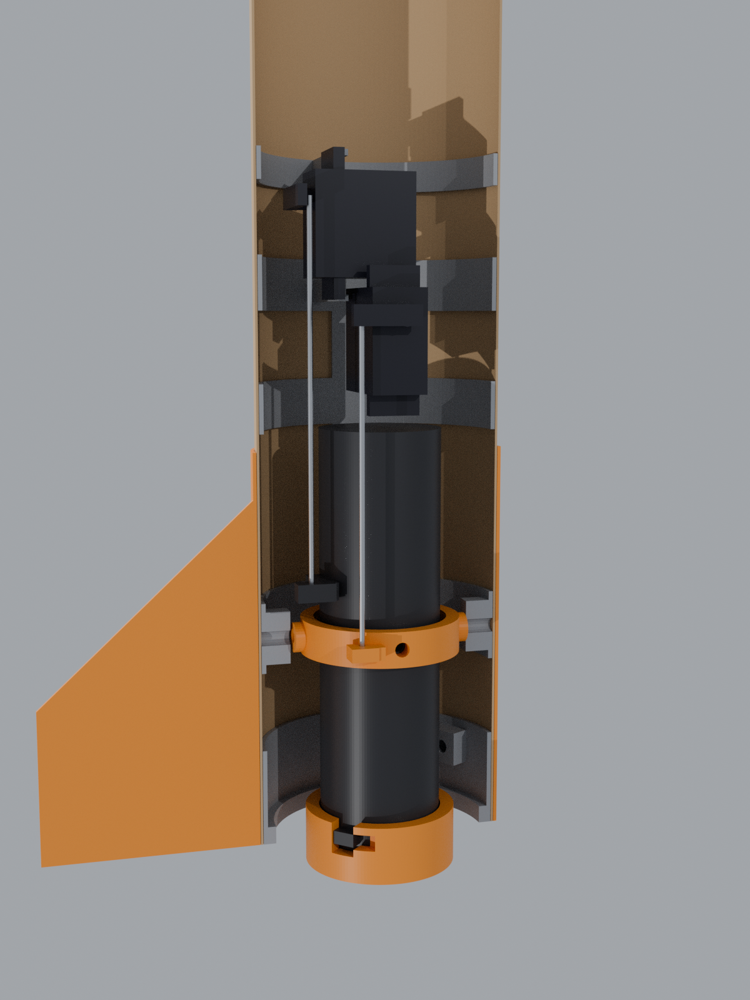

# KESTREL: a 1 m thrust-vector-controlled model rocket

A reusable, 3D-printed, ~1 m model rocket that **steers its motor** (two-axis thrust vector control) to fly
straight up to **~200 m**, releases its parachute **at apogee** with a servo latch (no pyrotechnics), films the
flight with a downward-looking camera, and logs IMU, barometer and GPS data on a **custom flight-computer PCB**
built around a Raspberry Pi Pico 2 W. Includes its own launch pad. **No soldering anywhere**: the PCB comes
assembled from JLCPCB and everything else plugs, screws or glues together. Estimated build cost **≈ £193**
(motors extra).

<p>




</p>

| | |
|---|---|
| Length / diameter | 948 mm / 56.3 mm (Estes BT-70 kraft tube) |
| Lift-off mass | 499 g with a TSP E20 (435 g without motor) |
| Motors | 24 mm TSP **E20-0** (mission), E12-0 (long-burn TVC demo), D20-0 (first hops) |
| Apogee (simulated, E20) | **197 m** nominal; Monte Carlo mean 196 m, 90 % of flights 170–228 m |
| Stability | 1.36 calibres static margin at lift-off: stable even if the TVC fails |
| TVC | 2-axis gimbal, ±6° vector limit, 2 × MG90S servos, 500 Hz control loop |
| Recovery | 24 in parachute, spring ejection, servo-released snap-in latch, 5.5 m/s landing |
| Flight computer | Pico 2 W + LSM6DSO IMU + BMP580 baro + ATGM336H GPS + 16 MB log, 4-layer 40 × 82 mm PCB |
| Camera | SQ12-class 23 mm cube, lens looking down the body from an external pod |
| Launch pad | printed hub, 3 dowel legs, 1 m × 6 mm rod, 0–15° tilt, blast tile |

## How it was verified

- **Simulation with the real flight code in the loop.** A 6-DOF simulator, validated against RocketPy (all
  quantities within 0.3 %), flies the actual C++ flight software 500 times a second.
  **Scenario and fault suite: 23 of 23 graded cases pass (plus an informational no-parachute case). 1000-flight Monte Carlo: 100 % success.**
  → [docs/SIMULATION_REPORT.md](docs/SIMULATION_REPORT.md)
- **CAD checked automatically on every run.** All 20 printed parts are watertight and printable. An exact-geometry
  interference check over 435 part pairs and a gimbal sweep in 24 directions at 7° both come back clean. Masses
  and positions feed the simulator, and the avionics bay is generated from the PCB's KiCad layout.
- **PCB**: schematic checked pin-for-pin, DRC clean, 0 unconnected; gerbers re-read by an independent viewer.
  → [docs/PCB.md](docs/PCB.md)
- **Firmware**: 303,064 flight-core checks, 59 firmware-logic checks, 0-warning cross-compile, ready-to-flash UF2.
  → [docs/FIRMWARE.md](docs/FIRMWARE.md)

The design went through many test-and-fix loops (see the iteration log in the simulation report). Real flights
then confirm what models cannot; [docs/TEST_PLAN.md](docs/TEST_PLAN.md) takes you from bench to 200 m in steps.

## Build it

1. **Order the PCB** (1–3 weeks): [docs/PCB.md → Ordering from JLCPCB](docs/PCB.md#ordering-from-jlcpcb)
2. **Buy the rest**: [docs/BOM.md](docs/BOM.md)
3. **Print and assemble**: [docs/BUILD_GUIDE.md](docs/BUILD_GUIDE.md)
4. **Flash and set up**: drag `firmware/pico/kestrel_fc.uf2` onto the Pico, then `calaxes`, `dirtest`, `tvctest`
5. **Test**: [docs/TEST_PLAN.md](docs/TEST_PLAN.md) → **fly**: [docs/PREFLIGHT_CHECKLIST.md](docs/PREFLIGHT_CHECKLIST.md)
6. **Read first**: [docs/SAFETY_AND_LEGAL.md](docs/SAFETY_AND_LEGAL.md) (UKRA/BMFA, CAA, motors, LiPo)

## What's where

```
design.json              master parameters: airframe, fins, TVC, recovery, every component's mass/position
cad/                     Blender + manifold3d parametric model
  kestrel_cad.py           blender -b -P cad/kestrel_cad.py -- [--no-render] [--fast] [--view=NAME]
  kestrel.blend            assembly, rocket on pad, exploded view, half sections, launch pad
  stl/                     20 print-ready STLs + check_report.md
  renders/                 the images above
  interference_report.md   part-pair and gimbal-sweep results
pcb/                     KiCad 7 project, circuit-as-code, autorouter, production files for JLCPCB
  kestrel_fc.kicad_pro/.kicad_sch/.kicad_pcb, kestrel_fc_schematic.pdf
  production/              gerbers zip, BOM + pick-and-place CSVs
firmware/
  core/                    flight core (estimation, TVC, state machine) + unit tests
  pico/                    Pico 2 W application, drivers, host tests; kestrel_fc.uf2 = ready to flash
  sil/                     simulator bridge (software-in-the-loop)
  tools/                   kestrel_link.py (USB shell, log download, plots), gen_motor_db.py
sim/                     6-DOF simulator, scenarios, Monte Carlo, RocketPy validation, results/
docs/                    BOM, build guide, PCB, firmware, test plan, checklist, safety, simulation report
```

## Change it

Everything is parametric and connected: edit `design.json` (or the PCB layout in `pcb/circuit.py`), then
re-run the chain. The CAD script stops with a message if `design.json` and the CAD/PCB disagree.

```bash
blender -b -P cad/kestrel_cad.py -- --no-render && python3 cad/check_parts.py && python3 cad/mass_properties.py
```

```bash
python3 firmware/tools/gen_motor_db.py && cmake --build firmware/build-host && (cd firmware/build-host && ctest)
```

```bash
cd sim && python3 scenarios.py && python3 montecarlo.py
```

Tools: Blender 4.0, KiCad 7, Python 3 (numpy, matplotlib, trimesh, manifold3d, rocketpy), Raspberry Pi Pico SDK 2.1,
arm-none-eabi-gcc.
