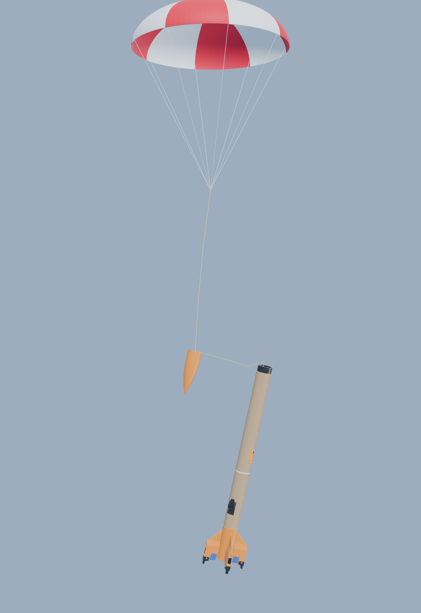
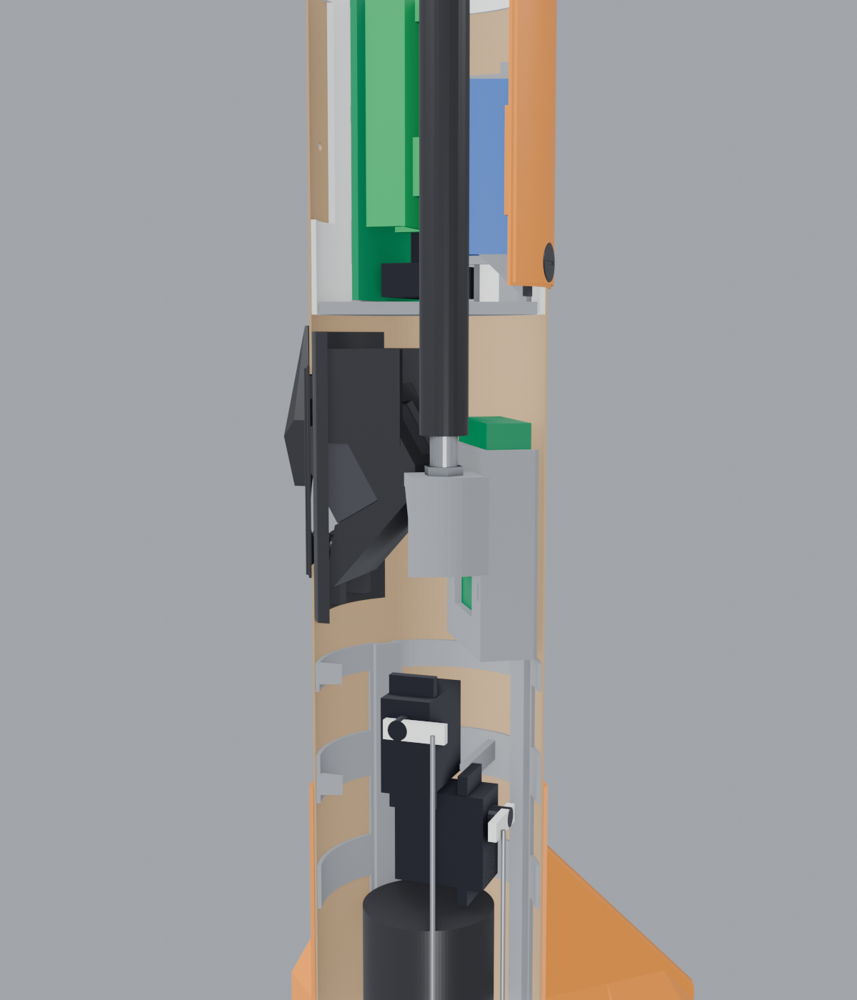

# KESTREL-2: a thrust-vector-controlled model rocket with four steerable fins

A reusable, 3D-printed, ~0.9 m model rocket that flies to about **157 m** on a TSP F35, **steers its motor**
(two-axis thrust vector control) and its
**four fin tabs** (roll, pitch and yaw; each tab's servo sits inside the thick bottom band of its fin and turns it
directly),
**stands up on its own four fins**, releases its parachute **at apogee**
with a servo latch under the nose cone (no pyrotechnics), carries a **payload of up to 50 g** behind a lockable
door, films the flight with a camera hidden inside it (looking out 30° down through a door with a lens port), logs
IMU, barometer and GPS data on a **custom flight-computer PCB** built around a Raspberry Pi Pico 2 W, and **sends
it all down live** over a licence-free 433 MHz telemetry radio (50 motion and 5 status frames a second) to
**Mission Control**, which flies the rocket on a 3D map as it happens and **predicts where it will land**. It
comes with its own launch pad. It is built to
**fly again and again**: the legs it stands and lands on are **replaceable** (one bolt each, and designed to be the
part that breaks after a hard landing, not the fin can), and a **battery hatch** with a gap-free door lets you swap
the LiPo and plug in USB between flights without taking anything apart. **No soldering
anywhere**: the PCB comes assembled from JLCPCB and everything else plugs, screws or glues together. Estimated
build cost **≈ £403–422** with the telemetry radio, ≈ £317 without it (motors extra).

<p>




</p>
<p>


</p>
<p>

</p>

**Simulated launch video** (ground camera, onboard camera, live telemetry bottom left, graphs below; every seed is a
different flight): [`kestrel2_flight_seed7.mp4`](sim/results/video/kestrel2_flight_seed7.mp4) (TSP F35, 4.9 m/s
wind, 20 g payload). Make another with `python3 sim/video/make_flight_video.py --seed N`.

**Mission Control** (the ground-station screen): a 3D map of the range with the rocket flying on it **live over the
radio**, the flight events as they happen (liftoff, burnout, apogee, parachute out, landed), telemetry, steering
dials and charts, the radio link's health, a **landing prediction** with a search ring and a position you can copy
to a phone map, and every flight saved for replay; after landing the full 500 Hz log comes in over USB and is merged
with the radio recording. Open [`ground/kestrel_mission_control.html`](ground/kestrel_mission_control.html) in Chrome
or Edge (one file, works offline); **Simulated live** shows a whole flight through a simulated radio link. See
[ground/README.md](ground/README.md).

| | |
|---|---|
| Parts | **3**: bottom (fin can + 4 replaceable legs + TVC module + camera behind its door + telemetry radio + flight computer + battery behind a hatch), middle (payload bay with door · wall · parachute bay · release latch at the top), nose cone |
| Length / diameter / fin span | 903 mm (929 mm standing on its fin feet) / 56.3 mm (Estes BT-70) / 159 mm |
| Lift-off mass | 952 g with a TSP F35 and 25 g of payload (861 g without motor) |
| Motors | 29 mm TSP **F35-0** (mission); 24 mm TSP **E20-0** for the first two flights, in a printed adapter sleeve (the D20 fits too, but is not in the flight programme) |
| Apogee (simulated, F35) | **157 m** nominal with 25 g of payload (164 m with an empty bay); Monte Carlo mean 166 m, 90 % of flights 135–200 m. E20: 41 m (about 47 m on the first flights, which carry no payload) |
| Stability | +0.72 to +0.84 calibres at lift-off (empty to full payload bay, with 51 g of nose ballast), +0.91 to +1.02 at burn-out: still flies straight enough to recover normally if all six steering servos fail |
| TVC | 2-axis gimbal for 29 mm motors, ±6° vector limit, 2 × MG90S, 500 Hz control loop |
| Fins | 4 × normal 4 mm fins with a half-round leading edge; only the bottom band (45 mm next to the tail) is 15 mm thick (17 mm round the servo), joined by a smooth 15° wedge, and holds the tab hinge, the tab servo (in a pocket open at the tip) and its lead channel; band and tabs taper to thin trailing edges below the tail |
| Multi-flight | **replaceable legs** (tough PLA, one M3 bolt onto a solid tongue under each fin tip; the post is the designed weak point at about 7.5 kg outward / 11.5 kg sideways at the foot, while the fin can holds about twice that); **battery hatch** on the rod side: the pack slides out and the Pico's USB socket is right there; the door sits on the tube and overlaps the opening by 2 mm all round |
| Fin tabs | 4 trailing-edge tabs, ±15°, each turned directly by an MG90S inside its fin (servo shaft = hinge line: no pods, pushrods or hinge pins); hold roll in boost and coast, share pitch/yaw with the TVC in the burn, steer alone in the coast |
| Recovery | 36 in parachute, spring ejection, servo-released snap-in latch, 5.2 m/s landing; from 157 m it drifts about 46 m for every 1 m/s of wind |
| Payload | 130 mm bay, 32 × 50 mm hinged door with a quarter-turn lock, 4 × M3 mounting holes, up to 50 g |
| Flight computer | Pico 2 W + LSM6DSO IMU + BMP580 baro + ATGM336H GPS + 16 MB log, 4-layer 40 × 82 mm PCB (v3), 7 servo ports, a radio socket |
| Telemetry | Holybro SiK V3 433 MHz pair, set to 8 dBm (≈ 6 mW e.r.p., inside the UK's 10 mW limit) and kept under the 10 %-an-hour airtime rule by the firmware; MAVLink-framed binary frames with a CRC, 50 motion + 5 status a second in flight, 1.5 a second on the pad. Receive only on the rocket: nothing sent from the ground changes the flight |
| Camera | SQ12-class 23 mm cube **inside** the bottom tube, in a cradle behind a door with a lens port and a low brow, looking out 30° down (the old external pod is gone: −71 % camera drag) |
| Launch pad | printed hub, 3 dowel legs, 1 m (or 1.5 m) × 6 mm rod, 0–15° tilt, 200 mm tile the rocket stands on |

## How it was verified

- **Simulation with the real flight code in the loop.** A 6-DOF simulator, checked against RocketPy (every
  quantity within 0.3 %), flies the actual C++ flight software 500 times a second, including the fin-tab mixer.
  **Scenario and fault suite: 44 of 44 graded cases pass** (plus 3 informational cases).
  **1500-flight Monte Carlo** (1000 on the F35, 400 on the E20, 100 on the D20): **1500 of 1500** meet every
  normal-flight criterion. A **first-flight study** of the E20 (700 flights: flight 1 with the fin tabs off, flight
  2 with them on, and 100 in more wind than allowed): 700 of 700, the canopy fully open at about 40 m. A stress Monte
  Carlo with about twice the error spreads and wind up to 9 m/s: 99.7 % meet every normal-flight criterion and
  99.9 % recover safely; a tab-effectiveness Monte Carlo: 200 of 200. About 3,700 simulated flights on the final design.
  → [docs/SIMULATION_REPORT.md](docs/SIMULATION_REPORT.md)
- **CAD checked automatically on every run.** All 40 printed parts are watertight, single-body and fit a
  220 × 220 × 250 mm bed, and an overhang check confirms they print as exported without support material (three
  marked parts excepted). Exact-geometry interference checks cover 2485 part pairs, plus sweeps of every mechanism
  through its full travel: the gimbal in 24 directions at 7° (with the F35 and with the 24 mm adapter, against the
  frame, servos, horns and pushrods), all four tabs at ±17°, the payload door through 0–100° and the release latch.
  All come back clean. Masses and positions feed the simulator, the av-bay is
  generated from the PCB's KiCad layout, and every number the firmware and simulator take from `design.json`
  (linkage ratios, tab geometry, leg geometry, IMU position, the camera door's brow) is checked against the CAD. The
  strength of every section of the fin, leg and tongue is computed from slices of the real CAD solid.
- **PCB** (v3, with the radio socket): schematic checked pin-for-pin against the circuit source, DRC 0
  violations, all 65 nets routed, gerbers re-read by an independent viewer. → [docs/PCB.md](docs/PCB.md)
- **Firmware** (v3.00): 375,585 flight-core checks (including the radio frames against pymavlink's reference
  frames and an hour stuck at full rate against the airtime limit), 148 firmware-logic checks, a 0-warning
  cross-compile and a ready-to-flash UF2. → [docs/FIRMWARE.md](docs/FIRMWARE.md)
- **Mission Control**: its radio decoder is tested against pymavlink frames and against a second, independent
  decoder in Python, including a damaged link; the whole page was run in a headless browser through a simulated
  flight (55 frames a second, no errors).

Honest gaps against what we agreed:

- **Apogee**: you asked for 200 m. On the 29 mm TSP F35 the rocket reached 188 m; making it a multiple-flight
  rocket added 48 g (170 m), and the telemetry radio, its antenna and cradles and 5 g more nose ballast to keep the
  same stability added another 48 g, so it now reaches **157 m** with 25 g of payload (164 m with an empty bay).
  Hiding the camera inside cut its drag by 71 % and won back a little of that. The TVC module takes 29 mm motors;
  the E20 flies in a printed adapter for the first two flights. The price of height is drift: about 30 s under the
  parachute, so it needs a recovery area of about 500 m downwind in winds up to 6 m/s, or 250 m if you fly it only
  in 3 m/s or less. The details, with what-if numbers, are in the simulation report, section 3.
- **Budget**: ≈ £317 without the radio against the ~£270 we aimed for (four extra servos, the larger 36 in
  parachute, the ejection spring that only comes in a pack of 10, the servos-in-the-fins design and the multi-flight
  parts); the radio adds ≈ £86–105. Two radio items (the antenna and the antenna extension) were not price-checked.
  → [docs/BOM.md](docs/BOM.md)
- **Not checked on real hardware yet**: the radio's range inside the rocket (its antenna stands inside the
  airframe, next to the wiring), and the masses of the radio parts (estimates). The test plan has a bench and a
  field range test before the first flight.

**Where the project stands, in one page:** [docs/STATUS.md](docs/STATUS.md).

Real flights then confirm what models cannot; [docs/TEST_PLAN.md](docs/TEST_PLAN.md) takes you from the bench to
the first F35 flight in steps (two E20 flights first: TVC only, then with the fin tabs).

## Build it

1. **Order the PCB** (1–3 weeks): [docs/PCB.md → Ordering from JLCPCB](docs/PCB.md#ordering-from-jlcpcb)
2. **Buy the rest**: [docs/BOM.md](docs/BOM.md)
3. **Print and assemble**: [docs/BUILD_GUIDE.md](docs/BUILD_GUIDE.md)
4. **Flash and set up**: drag `firmware/pico/kestrel_fc.uf2` onto the Pico, then `calaxes`, `dirtest`, `tabtest`,
   `tvctest`, `fintest`
5. **Test**: [docs/TEST_PLAN.md](docs/TEST_PLAN.md) → **fly**: [docs/PREFLIGHT_CHECKLIST.md](docs/PREFLIGHT_CHECKLIST.md)
6. **Read first**: [docs/SAFETY_AND_LEGAL.md](docs/SAFETY_AND_LEGAL.md) (UKRA/BMFA, CAA, motors, LiPo, wind limits)

## What's where

Every file is listed and explained in [FILES.md](FILES.md).

```
design.json              master parameters: airframe, fins + tabs, TVC, payload, recovery, every component's mass/position
cad/                     Blender + manifold3d parametric model
  kestrel_cad.py           blender -b -P cad/kestrel_cad.py -- [--no-render] [--fast] [--view=NAME]
  kestrel.blend            scene 1: complete rocket + the same rocket cut open + every part laid out with its name;
                           scenes 2-7: exploded view, cut-aways, door open, tabs deflected, fin cut open, on the launch pad
  kestrel_rocket.blend     just the constructed rocket, every part in place; hide "Body tubes" to look inside
  kestrel_tvc_module.blend the TVC module on its own (its two servo leads come out of the top) + assembly steps
  kestrel_parachute_open.blend  the rocket descending under its open parachute
  stl/                     40 print-ready STLs + check_report.md (3 of them: the 24 mm motor adapter set)
  renders/                 the images above
  interference_report.md   part pairs and mechanism sweeps
pcb/                     KiCad 7 project, circuit-as-code, autorouter, production files for JLCPCB
  kestrel_fc.kicad_pro/.kicad_sch/.kicad_pcb, kestrel_fc_schematic.pdf
  production/              gerbers zip, BOM + pick-and-place CSVs, assembly drawing
firmware/
  core/                    flight core (estimation, TVC, fin-tab mixer, state machine) + unit tests
  pico/                    Pico 2 W application, drivers, host tests; kestrel_fc.uf2 = ready to flash
  sil/                     simulator bridge (software-in-the-loop)
  tools/                   kestrel_link.py (USB shell, log download, plots, radio recorder), gen_motor_db.py
sim/                     6-DOF simulator, scenarios, Monte Carlo, first-flight study, RocketPy validation, results/
  run_all.sh               every simulation suite in order (about 45 min on 4 cores)
  video/                   launch-video pipeline (simulation → Blender → telemetry + graphs → MP4)
docs/                    shopping list, build guide, PCB, firmware, test plan, checklist, safety, simulation report
ground/                  Mission Control: kestrel_mission_control.html = live radio, 3D map, landing prediction, replay (offline)
  radio_frames.py, test_radio.mjs   the radio frame format in Python + the page decoder's tests
```

## Change it

Everything is parametric and connected: edit `design.json` (or the PCB layout in `pcb/circuit.py`), then
re-run the chain. The CAD script stops with a message if `design.json` and the CAD/PCB disagree.

```bash
blender -b -P cad/kestrel_cad.py -- --no-render && python3 cad/check_parts.py && python3 cad/mass_properties.py
```

```bash
python3 firmware/tools/gen_motor_db.py && cmake --build firmware/build-host && (cd firmware/build-host && ctest)
```

```bash
sh sim/run_all.sh
```

Tools: Blender 4.0, KiCad 7, Python 3 (numpy, matplotlib, pillow, trimesh, manifold3d, rocketpy), ffmpeg,
Raspberry Pi Pico SDK 2.1, arm-none-eabi-gcc.
