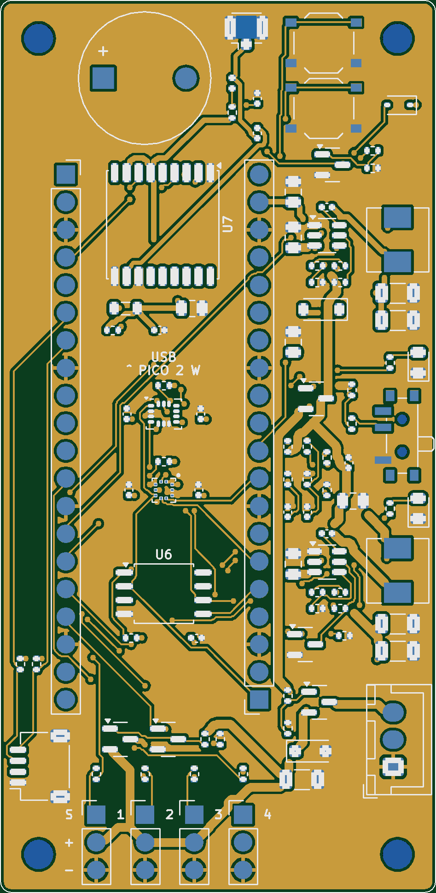

# KESTREL FC: the flight-computer PCB

A 40 × 82 mm, 4-layer carrier board for the Raspberry Pi Pico 2 W, designed in **KiCad 7**. Open
`pcb/kestrel_fc.kicad_pro` in KiCad 7 or newer. Every SMD part is placed by JLCPCB and the through-hole
parts (Pico sockets, servo headers, battery plug, buzzer) are soldered by JLCPCB too, so **you never solder
anything**.

## What is on it

| Block | Parts | Notes |
|---|---|---|
| Brain | Raspberry Pi Pico 2 W (RP2350, 150 MHz Cortex-M33 with FPU) on 2 × 20 sockets | swap or upgrade without tools |
| Inertial | LSM6DSO 6-axis IMU, SPI, 833 Hz, ±16 g / ±2000 °/s | 3.3 V plane under it, decoupled |
| Altitude | Bosch BMP580 barometer, SPI, 50 Hz | static ports in the tube; av-bay sealed from the motor section |
| Position | ATGM336H-5N31 GPS + BeiDou, UART, 5 Hz, active-antenna bias-T, U.FL | recovery: last position is logged and beeped |
| Memory | W25Q128JV 16 MB SPI NOR | ≈ 30 flights of 500 Hz data |
| Power in | 2S LiPo through its **JST-XH balance plug** | reverse-polarity P-FET, 13 V TVS, both cells monitored |
| Power switch | PCM12 slide switch driving a P-FET soft switch | reachable through the slot in the airframe |
| Servo power | TPS563201 3 A buck → 5 V, switchable from GP3 | servo rail voltage monitored |
| Logic power | second TPS563201 → 5 V → Schottky → Pico VSYS | USB and battery can both be connected |
| Outputs | 4 servo headers (TVC ring, TVC motor, deploy latch, aux/camera), switched 5 V AUX, buzzer, 2 LEDs | |
| Expansion | Qwiic / STEMMA-QT I²C connector | add sensors later without soldering |
| Inputs | USER and RESET buttons | |

Pico pin map (also in `firmware/pico/src/board.hpp`):

| GP | Signal | GP | Signal |
|---|---|---|---|
| 0 / 1 | GPS UART TX / RX | 14 | USER button |
| 2 | GPS PPS | 15 | IMU INT1 |
| 3 | servo power off | 16 / 18 / 19 | SPI0 MISO / SCK / MOSI |
| 4 / 5 | Qwiic SDA / SCL | 17 / 20 / 21 | CS IMU / baro / flash |
| 6 – 9 | servo PWM 1 – 4 | 22 | baro INT |
| 10 | buzzer | 26 / 27 / 28 | ADC: battery / cell 1 / servo rail |
| 11 / 12 | LED green / red | 13 | AUX 5 V enable |

## Design files

| File | What |
|---|---|
| `pcb/circuit.py` | the circuit as code: every part, LCSC number, pin-to-net map and placement. Single source of truth |
| `pcb/gen_schematic.py` → `kestrel_fc.kicad_sch`, `kestrel_fc_schematic.pdf` | schematic generated from `circuit.py` |
| `pcb/check_netlist.py` | exports KiCad's own netlist from the schematic and checks it pin-for-pin against `circuit.py` + electrical rules |
| `pcb/board_build.py`, `pcb/router.py`, `pcb/gen_pcb.py` | placement, a purpose-written A* autorouter (4 layers, net classes, via rules), pours, silkscreen, DRC |
| `pcb/jlc_fab.py` → `pcb/production/` | gerbers + drill (zip), BOM and pick-and-place in JLCPCB format with rotation corrections |
| `pcb/production/kestrel_fc_assembly_top.pdf` | top-side assembly drawing (part outlines + designators): use it to check the placement preview when ordering |
| `pcb/export_mech.py` → `pcb/build/mech_interface.json` | holes, pin tails, switch/LED positions for the CAD model (the av-bay is built around the real board) |

## Verification

| Check | Result |
|---|---|
| Schematic vs circuit, pin by pin (KiCad netlist export) | **matches exactly**, ERC checks pass |
| Courtyard overlaps after placement | **0** |
| Routing | **all 64 nets routed, 0 unconnected pads** |
| KiCad DRC (clearance 0.13 mm, track 0.18 mm, via 0.55/0.3 mm, 0.3 mm copper-to-edge) | **0 errors**; 1 intentional warning: the U.FL footprint allows one solder-mask opening across its pads (as the manufacturer's land pattern does) |
| Gerbers re-read by an independent viewer (gerbv) | outline 40.00 × 82.00 mm, 4 copper layers, planes and drills as designed |
| Board fits the airframe | checked in the CAD: standoffs on the real mounting holes, clearance slots behind every pin tail, switch and LEDs under the airframe slot, no interference with any other part |

Stack-up: F.Cu signals · In1 solid GND · In2 +3.3 V plane · B.Cu signals + GND pour. Rules are well inside
JLCPCB's standard 4-layer capability, so no extra-cost options are needed.

## Ordering from JLCPCB

1. **jlcpcb.com → Order now → Add gerber file**: upload `pcb/production/kestrel_fc_gerbers_jlcpcb.zip`. It is
   detected as 4 layers, 40 × 82 mm. Quantity 5, thickness 1.6 mm, any colour, HASL lead-free, default 4-layer
   stack-up. "Remove order number: specify a location" (the back silkscreen has the `JLCJLCJLCJLC` marker).
2. **PCB Assembly: on.** Economic, top side, **2 boards**, tooling holes added by JLCPCB. Confirm.
3. Upload `kestrel_fc_bom_jlcpcb.csv` (BOM) and `kestrel_fc_cpl_jlcpcb.csv` (pick-and-place).
4. All 41 BOM lines should match. If a passive is out of stock, pick the suggested equivalent with the same value
   and package. If a sensor or the GPS is out of stock, wait or ask in an issue: don't substitute blindly.
5. **Placement preview: check pin 1** of U2/U3 (TPS563201, community rotation correction applied), U4 (LSM6DSO),
   U5 (BMP580), U6 (flash), U7 (GPS module), the diodes' cathode bars, the LEDs, J7 (Qwiic cable entry at the
   board edge). Rotations come from the KiCad/JLCPCB community correction table; JLCPCB's engineers also check
   every order before it is built.
6. Make sure the **through-hole parts** (J1, J2–J5, J10, J11, BZ1) are selected for assembly. If Economic won't
   take them, switch to Standard PCBA (≈ £15 more).
7. Pay. Production is about a week, then shipping.

## First power-up

1. Look at the boards. Plug the Pico 2 WH in, USB connector towards the GPS end.
2. USB only first: green+red LEDs, then `status` over USB should show IMU, baro and log flash `ok` (servo rail and
   battery read 0 V on USB power: they run from the LiPo).
3. Plug the LiPo (switch off), switch on: `status` shows both cell voltages and ≈ 5 V on the servo rail.
4. Continue with the set-up in [BUILD_GUIDE.md §9](BUILD_GUIDE.md#9-firmware-and-set-up-usb-no-tools-needed).
