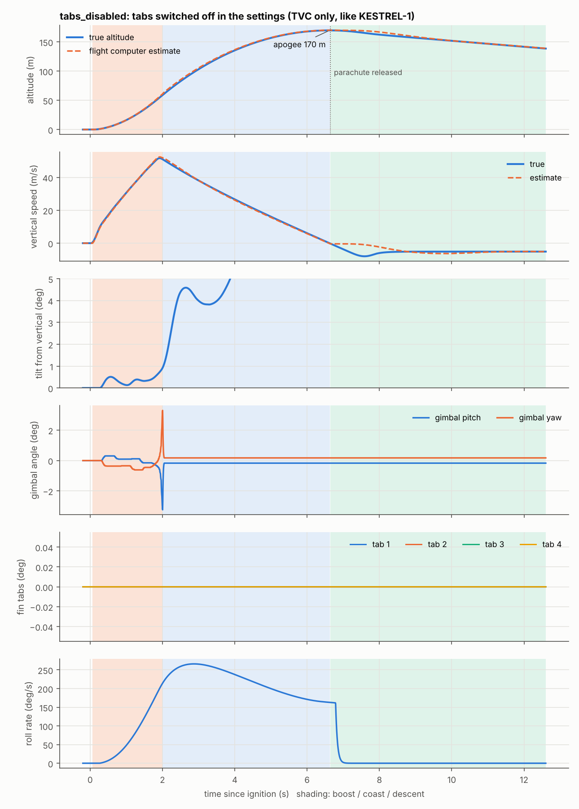

# Simulation and test report (KESTREL-2)

**Bottom line.** Flown by the real flight code in a 6-DOF simulator, KESTREL-2 on a TSP E20 reaches **77 m** in
calm air with a 25 g payload (Monte Carlo mean **83 m**, 90 % of flights between 64 and 103 m). It held its roll
angle to within a few degrees and the launch direction to within 3.5° during the burn (95th percentile). It
released the parachute within ±0.1 s of apogee and landed at about 5.5 m/s in **1000 of 1000 randomised flights**
(E20 and D20). **40 of 40 graded scenario and fault cases pass.** An independent simulator (RocketPy) agrees
within 0.3 %.

The apogee is well below the ~123 m I estimated when we chose the motor. Section 3 explains why, with numbers.

## 1. How the rocket is simulated

`sim/kestrel/` is a purpose-built 6-DOF simulator:

| Model | Details |
|---|---|
| Rigid body | quaternion attitude, 500 Hz; mass, CG and inertia (roll and pitch) vary as the propellant burns |
| Mass properties | printed parts from the **actual CAD meshes** with their print settings (`cad/mass_properties.json`), tubes from density, every bought part where the CAD puts it (`cad/component_positions.json`), payload 0–50 g in the bay |
| Aerodynamics | Barrowman normal force and centre of pressure (nose, body, 4 fins with body interference), pitch and roll damping; drag build-up: roughness-limited skin friction (body, fins, legs), fin edges, base drag (reduced while the motor burns), camera pod, **4 tab-servo pods, tab linkages and fin feet**, launch lugs, gimbal gap, +8 % allowance |
| Fin tabs | each tab's force acts along its own fin's normal at its own position, so the four tabs make roll, pitch and yaw moments exactly as their geometry dictates; effectiveness 0.45 of an all-moving surface of the same area; servo model with speed limit, lag, dead-band, backlash, trim error, the real horn/pushrod linkage, and fault modes (stuck, hard-over, dead) |
| Motors | TSP D20, E12, E20, F35 and Estes thrust curves (ThrustCurve.org data via OpenRocket), **scaled to the manufacturer's rated impulse and burn time** (UKROC list); `KESTREL_MOTOR_BASIS=curve` flies the raw curves |
| Environment | ISA atmosphere at the site altitude, wind with Gauss–Markov gusts, launch rod (length and tilt) with friction |
| TVC | two-axis gimbal with 50 Hz servo frames, servo speed limit, lag, dead-band, backlash, trim error |
| Sensors | IMU noise, bias, bias drift, misalignment and lever-arm effects; barometer noise, rate and static-port error; GPS at 5 Hz |
| Recovery | latch delay, parachute fill time and drag; ground contact and landing detection |
| **Flight software** | **`firmware/core` compiled as a shared library and called 500 times a second, exactly as on the Pico (software-in-the-loop)**: every number on this page comes from the code that will fly |

## 2. Validation against RocketPy

The same airframe (same drag curve, mass properties, motor) flown passively in
[RocketPy](https://github.com/RocketPy-Team/RocketPy), no wind (`sim/validate_rocketpy.py` →
`sim/results/rocketpy_validation.md`):

| Motor | Apogee | Apogee time | Max speed | Rod-exit speed | Static margin |
|---|---|---|---|---|---|
| TSP E20 | 77.48 vs 77.43 m (+0.1 %) | 4.88 vs 4.87 s | 30.56 vs 30.55 m/s | 7.66 vs 7.66 m/s | 0.77 vs 0.77 cal |
| TSP D20 | 28.52 vs 28.49 m (+0.1 %) | 2.86 vs 2.86 s | 19.11 vs 19.11 m/s | 8.07 vs 8.08 m/s | 0.86 vs 0.85 cal |
| TSP E12 | 69.72 vs 69.65 m (+0.1 %) | 5.61 vs 5.61 s | 24.35 vs 24.33 m/s | 6.11 vs 6.11 m/s | 0.77 vs 0.77 cal |

Every quantity agrees within 0.3 %. This checks the flight mechanics; the drag and mass inputs are checked in
section 3 and by real flights.

## 3. Why ~77 m and not the ~123 m estimate

When we chose the motor I estimated about 123 m on the E20 for a rocket of about 650 g with 50 g of payload, using
the E20's published thrust curve (40 Ns). Three things differ in the finished design:

1. **Mass.** The finished rocket weighs **723 g** at lift-off with 25 g of payload (748 g with 50 g). Seven servos
   are 99 g, the one-piece fin can with its legs and pods is 118 g, the latch insert and coupler 56 g.
2. **Rated impulse.** The UK approved-motor list rates the E20 at **36 Ns**; the published test curve integrates to
   40 Ns. The simulator uses the rated value. If your motors match the curve, add about 17 m.
3. **Drag.** The pods, linkages and legs add drag, but at these speeds (31 m/s at most) drag matters far less
   than mass.

Drag build-up at 40 m/s, coasting (`Cd0` = 0.92 including the 8 % allowance):

| Term | Cd | | Term | Cd |
|---|---|---|---|---|
| body skin friction | 0.261 | | tab linkages | 0.064 |
| tab-servo pods (4) | 0.162 | | fin + leg skin friction | 0.063 |
| base drag | 0.122 | | launch lugs (2) | 0.037 |
| camera pod | 0.070 | | fin edges, nose, feet, gimbal gap | 0.060 |

What-if flights (passive, calm, same simulator):

| Change | E20 apogee |
|---|---|
| **as designed** (rated 36 Ns, 25 g payload) | **77.5 m** |
| empty payload bay / maximum 50 g payload | 83.5 m / 71.9 m |
| E20 delivering its published curve (40 Ns) | 94.3 m |
| no external tab pods or linkages at all (−27 % drag) | 79.6 m |
| 50 g lighter / 100 g lighter | 90.1 m / 104.8 m |
| TSP F35 (29 mm, 65 Ns), which would need a 29 mm TVC module | 225 m |

So each 10 g saved is worth about 2.5 m, while hiding the tab servos inside the body would gain only about 2 m.
Reaching ~123 m on an E20 would need the rocket to lose roughly 180 g, which it cannot do with every agreed
feature on board. The motor that would clearly exceed it is the TSP F35, at the cost of a 29 mm TVC module.

## 4. Scenario and fault-injection suite

`sim/scenarios.py`: 43 deterministic cases, each flying the real flight code
(all results: `sim/results/scenarios.md`; plots: `sim/results/scenario_*.png`).

Pass criteria for normal flights: tilt during the burn < 10°, roll rate during the burn < 60 °/s (the tabs hold
roll), parachute released within 1.5 s of true apogee at < 15 m/s, landing < 7 m/s, firmware reaches LANDED.
Fault cases must end with a parachute and a landing below 7 m/s; the jammed-TVC case must also stay near the pad.

| Case | Apogee | Tilt burn / coast | Roll rate burn | Deploy − apogee | Landing | Result |
|---|---|---|---|---|---|---|
| E20, calm | 77 m | 0.4° / 0.1° | 2 °/s | +0.05 s | 5.4 m/s | PASS |
| E20, 3 m/s + gusts (baseline) | 77 m | 0.5° / 2.7° | 3 °/s | +0.05 s | 5.4 m/s | PASS |
| E20, 6 m/s + 1.5 m/s gusts (1 m rod / 1.5 m rod) | 77 / 77 m | 0.6° / 7.5° | 2 °/s | +0.04 / +0.04 s | 5.4 m/s | PASS |
| E20, 9 m/s + 2 m/s gusts (wind limit) | 77 m | 1.0° / 13.7° | 2 °/s | +0.04 s | 5.4 m/s | PASS |
| payload 0 g / 50 g / 50 g in 6 m/s wind | 83 / 72 / 72 m | ≤ 0.6° | ≤ 3 °/s | ≤ +0.05 s | 5.3–5.5 m/s | PASS |
| rod tilted 5° downwind | 76 m | 5.0° / 5.1° | 5 °/s | +0.03 s | 5.4 m/s | PASS |
| 1.5° thrust misalignment | 77 m | 1.3° / 3.0° | 2 °/s | +0.03 s | 5.4 m/s | PASS |
| 2° fin cant (strong roll torque) / crooked fins | 77 / 77 m | 0.4° / 0.5° | 15 / 5 °/s | +0.05 s | 5.4 m/s | PASS |
| CG 20 mm aft / 15 % heavier / 20 % more drag | 77 / 58 / 76 m | ≤ 0.5° | ≤ 3 °/s | ≤ +0.05 s | 5.4–5.8 m/s | PASS |
| TVC gains ×0.5 / ×2, tab gains ×0.5 / ×2 | 77 m | ≤ 1.1° | 1–7 °/s | +0.05 s | 5.4 m/s | PASS |
| tabs 40 % less / more effective | 77 m | 0.6° / 0.5° | 4 / 3 °/s | +0.05 s | 5.4 m/s | PASS |
| slow servos, IMU 2° crooked, gyro drift 10× | 77 m | ≤ 0.7° | ≤ 3 °/s | +0.05 s | 5.4 m/s | PASS |
| camera panorama roll (90 °/s in the coast) | 77 m | 0.5° / 2.0° | 3 °/s | +0.05 s | 5.4 m/s | PASS |
| tabs switched off (TVC only, like KESTREL-1) | 77 m | 0.5° / 13.9° | **131 °/s** | +0.04 s | 5.4 m/s | PASS (rolls fast) |
| TSP D20 / E20 performing like its curve (40 Ns) | 28 / 94 m | 0.5° | 2–3 °/s | +0.04 s | 5.4 m/s | PASS |
| **FAULT** launched 1 s after switch-on | 73 m | 24° / 40° | 131 °/s | +0.04 s | 5.4 m/s | PASS (steering stays centred) |
| **FAULT** TVC servos dead, calm / 3 m/s | 77 / 77 m | 3.2° / 3.6° | 2 °/s | +0.05 s | 5.4 m/s | PASS (tabs steer) |
| **FAULT** TVC pitch servo jams at full deflection at T+0.5 s | 17 m | loops | 29 °/s | −0.80 s (abort) | 5.4 m/s | PASS: abort, parachute out, lands 21 m from the pad |
| **FAULT** tab 1 jams at full deflection at T+1 s | 72 m | 1.7° / tumbles | 70 °/s | +0.02 s | 5.4 m/s | PASS (give-up rule, chute at apogee) |
| **FAULT** tab 2 freezes / all four tab servos dead | 77 / 77 m | 0.6° / 0.7° | 8 / 131 °/s | +0.05 s | 5.4 m/s | PASS |
| **FAULT** all six steering servos dead: calm / 3 m/s / 3 m/s with an empty bay | 74 / 74 / 80 m | 20° / 23° / 23° | 129–143 °/s | +0.04 s | 5.3–5.4 m/s | PASS (passively stable) |
| **FAULT** barometer dies at T+1 s | 77 m | 0.5° / 1.2° | 5 °/s | +1.27 s | 5.4 m/s | PASS (inertial apogee) |
| **FAULT** all steering dead in 6 m/s wind | 48 m | 108° | 115 °/s | −1.47 s (abort) | 5.3 m/s | INFO: why flights 1–3 need ≤ 3 m/s |
| **FAULT** parachute never opens | 77 m |  |  |  | **36 m/s** | INFO: why ground ejection tests matter |
| TSP E12-0 | 70 m | 0.3° | 2 °/s | +0.06 s | 5.4 m/s | INFO: leaves the rod at only 6.1 m/s, not recommended |


## 5. Monte Carlo

`sim/montecarlo.py`: 1000 flights, each with everything randomised at once: wind 0–6 m/s from any direction plus
gusts, payload 0–50 g, motor impulse (mean +3 %, 1 σ 5 %: the rated value is the conservative end) and burn time,
mass (4 %), CG (8 mm), drag (8 %), fin lift (7 %), thrust misalignment, fin cant and per-fin misalignment, rod
tilt, TVC and tab servo trim/speed/lag/backlash, tab effectiveness (15 %), gyro and accelerometer bias, IMU
misalignment, baro noise and port error, parachute Cd and fill time, latch delay, site altitude. A flight counts as
a success only if it meets all the normal-flight pass criteria above.


| | TSP E20 (800 flights) | TSP D20 (200 flights) |
|---|---|---|
| **Success** | **100 %** | **100 %** |
| Apogee mean (5–95 %) | **83 m** (64–103) | 31 m (24–38) |
| Max tilt during the burn, mean / 95 % | 1.7° / 3.5° | 1.7° / 3.4° |
| Max roll rate during the burn, mean / 95 % | 2.9 / 7.0 °/s | 2.2 / 4.8 °/s |
| Largest roll-angle error before apogee, 95 % | 8.3° | 6.0° |
| Max gimbal, mean / 95 % | 0.9° / 1.7° | 0.9° / 1.6° |
| Deploy − apogee, 5–95 % | −0.06 … +0.11 s | −0.02 … +0.09 s |
| Airspeed at deploy, mean / 95 % | 3.4 / 6.7 m/s | 2.3 / 4.5 m/s |
| Landing speed, mean / max | 5.5 / 6.5 m/s | 5.4 / 6.6 m/s |
| Landing distance, mean / 95 % / max | 64 / 133 / 183 m | 20 / 43 / 48 m |
| Rod-exit speed, mean | 7.8 m/s | 8.3 m/s |


Two things in the histograms are expected, not faults:

- **Tabs at their 15° limit near apogee.** In wind, as the rocket slows, the coast attitude hold asks the tabs to
  keep it vertical against weathercocking. Below about 15 m/s they cannot (holding an angle of attack α needs about
  0.8 α of tab), so they saturate. Once the rocket is 25° off course the give-up rule centres them.
- **A few large tilts at apogee on the D20** (95 % below 22°, a handful above 60°). At 6 m/s near apogee in 5 m/s
  of wind the rocket turns to follow the relative wind, as any stable rocket does. The parachute still opens within
  0.14 s of apogee at under 7 m/s in every case.

Run time: about 12 minutes on 4 CPU cores.

## 6. What the fin tabs do

With the tabs switched off (`tabs_disabled`) the rocket rolls at 131 °/s during the burn and 153 °/s in the coast:
fine for the flight, useless for the camera. With the tabs it holds its roll angle to within 8° (95 %) and
tilts less in the coast (2.7° instead of 13.9° in the baseline wind). They also steer on their own if the TVC fails,
and `rollprog` turns the coast into a slow camera panorama.



## 7. Design iterations: what testing changed

| Found by | Problem | Fix |
|---|---|---|
| Interference check (1711 part pairs) | nose sleeve and insert shoulder overlapped; door-frame arm poked through the tube; servo horns sat on the splines | shoulder shortened, arm clipped to the tube, horns bored: **no overlaps** |
| Release-latch check | the bolt engaged the nose sleeve by only 0.85 mm | bolt lengthened: 1.05 mm engagement when locked, 2.45 mm clearance when released |
| Printability check | sealed nose cavity, coincident faces, tiny gaps made several STLs non-watertight or multi-body | vent hole, merged solids: **all 27 parts single-body and watertight** |
| Fault scenario (jammed tab) | one tab jammed at 8° made the rocket tumble | mixer controls roll first and clips each tab on its own; spin guard; give-up rule. An 8° jam now flies normally; a full hard-over still tumbles in the coast but the parachute opens at apogee |
| Motor data check | the E20 curve file integrates to 40 Ns but the motor is rated 36 Ns | simulator scales every curve to its rated impulse (apogee 95 → 78 m) |
| PCB DRC | silkscreen overlaps after adding 3 servo ports; a starved thermal relief | labels moved, solid connection: **0 violations** |
| Build-guide walk-through | the tab-servo lead holes (4 × 7 mm) were smaller than a servo plug | full-length 4 × 19 mm slots through pod floor, fin can and tube |
| Build-guide walk-through | the CAD drew only 4 of the 7 servo plugs on the board | mechanical export fixed; the other 3 checked for interference: none |
| Build-guide walk-through | a servo plug cannot pass the notch in the parachute wall | release lead is laid along the tube before the wall is glued in |
| Build-guide walk-through | the GPS antenna bias resistor would put 3.3 V on a passive antenna | R24 not fitted |
| Passive-flight scenarios | with every steering servo dead the rocket is safe in 3 m/s but not in 6 m/s | wind limit 3 m/s for flights 1–3; 1.5 m rod above 3 m/s |
| Balance check | the limit did not allow for an empty payload bay | limit 640 mm from the nose tip |
| Firmware tests | a synthetic boost was too strong for the rated-impulse timing | test profile corrected; 377,489 core checks pass |
| New overhang check (every STL in its print orientation) | flat 55 mm ceilings printed in mid-air (nose bulkhead, parachute wall), a piston and a door laid the wrong way up, an unsupported GPS shelf, hanging nut blocks and lug | 45° conical nose bulkhead, wall skirt moved up, orientations fixed, gusseted GPS platform, 45° wedges: only 4 parts still need supports, and the check now runs on every CAD build |
| GPS platform re-design | the old antenna shelf sat 20 mm above the Pico's USB socket and had no way out for the antenna lead | U-shaped platform beside the socket: a USB cable plugs in with the av-bay assembled |
| New CAD ↔ design check | the TVC linkage is 9 mm horn / 18 mm arm = 0.50 gimbal degrees per servo degree, but firmware and simulator assumed 0.42 (the gimbal would have moved 19 % more than commanded, to 7.1° at the 6° limit); the tab horn was 14.3 mm, not 14.5 | `design.json`, simulator and firmware 2.01 corrected; the CAD script now refuses to build if they disagree |

## 8. The launch video

`sim/results/video/kestrel2_flight_seed7.mp4` (4.9 m/s wind, 20 g payload) and `kestrel2_flight_seed16.mp4` (almost
calm, 26 g payload) are two randomised flights from the same simulator with the real flight code, rendered in
Blender: ground camera and onboard camera side by side, live telemetry bottom left, graphs below. The fin tabs
move by their simulated angles; the parachute opens as the simulator says it does. Make another (each seed is a
different flight: wind, gusts, payload, motor performance, sensor errors):

```bash
cd sim && python3 video/make_flight_video.py --seed 12
```

## 9. What only real flights can confirm

The model is only as good as its inputs. The test plan ([TEST_PLAN.md](TEST_PLAN.md)) checks the uncertain ones in
order: tab effectiveness (the largest uncertainty, ±40 % tested), printed-part drag and finish, TSP motor-to-motor
variation, gimbal and tab-linkage friction, parachute opening, static-port error, and the JLCPCB part rotations
(checked visually at ordering). Compare every flight log with the simulation (`firmware/tools/kestrel_link.py
plot`) before moving to the next step.

## Reproduce everything

```bash
pip install numpy matplotlib rocketpy trimesh manifold3d
```

```bash
cmake -S firmware -B firmware/build-host && cmake --build firmware/build-host -j
```

```bash
cd sim && python3 scenarios.py && python3 montecarlo.py && python3 plot_montecarlo.py && python3 validate_rocketpy.py
```
