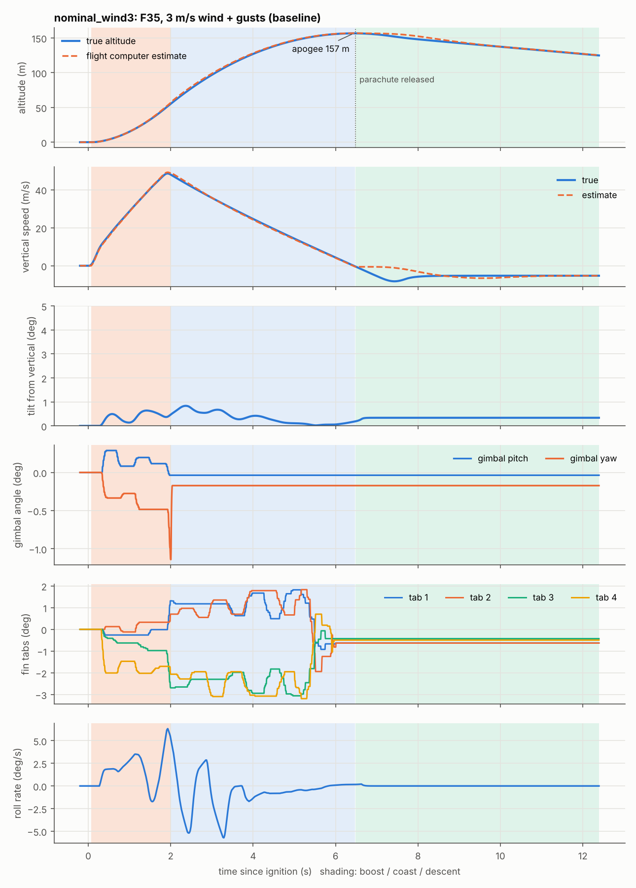
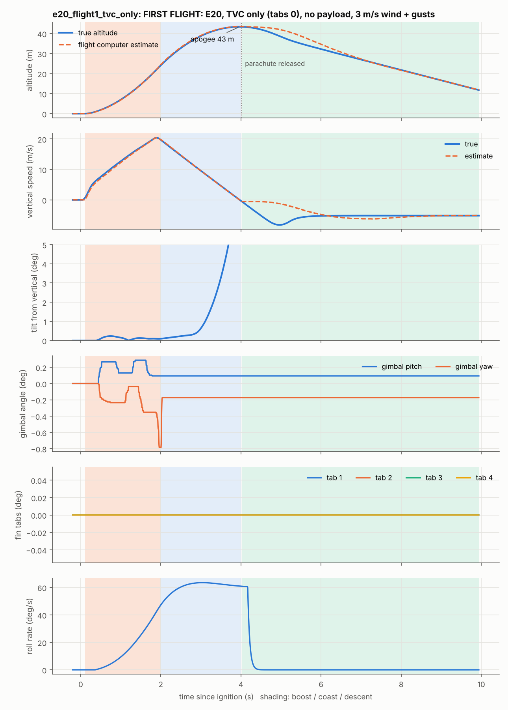
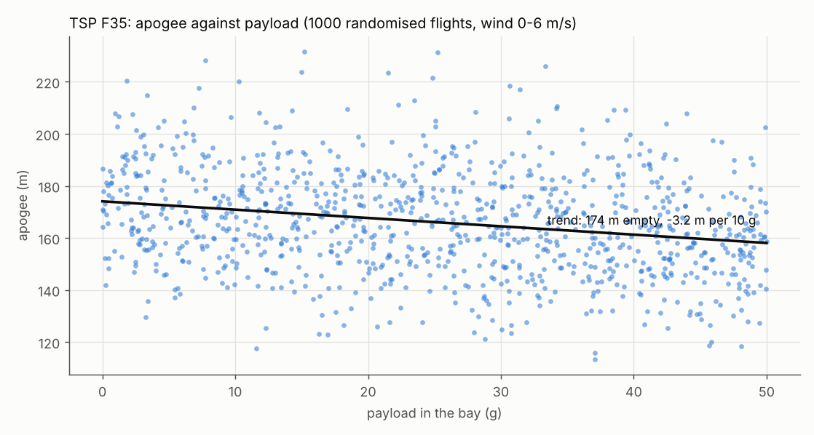

# Simulation and test report (KESTREL-2)

**Bottom line.** Flown by the real flight code in a 6-DOF simulator, KESTREL-2 on a TSP F35 reaches **157 m** in
calm air with a 25 g payload (Monte Carlo mean **166 m**, 90 % of flights between 135 and 200 m).
It held its roll angle to within 11° and the launch direction to within 3.6° during the burn
(95th percentile). It released the parachute within 0.29 s of apogee (95 % within 0.15 s) and landed at about
5.2 m/s in **1500 of 1500 randomised flights** (F35, and the E20 and D20 in their 24 mm adapter).
**44 of 44 graded scenario and fault cases pass.** The first-flight study of the E20 (700 flights) and the
stress and tab-effectiveness Monte Carlos are in section 5. An independent simulator (RocketPy) agrees within
0.3 %.

You asked for 200 m. On the 29 mm F35 the airframe reached 188 m; the multiple-flight changes (replaceable legs,
stronger servo housings, battery hatch, more nose ballast) cost 48 g (170 m), and the telemetry radio with its antenna
and cradles, plus 5 g more nose ballast to keep the same stability, another 48 g: it now reaches 157 m (164 m
with an empty payload bay); section 3 shows what more height would cost.
The price of height is drift: under its parachute the rocket comes down for about 30 s, so it lands 139 m from
the pad on average and up to 432 m in winds up to 6 m/s.

## 1. How the rocket is simulated

`sim/kestrel/` is a purpose-built 6-DOF simulator:

| Model | Details |
|---|---|
| Rigid body | quaternion attitude, 500 Hz; mass, CG and inertia (roll and pitch) vary as the propellant burns |
| Mass properties | printed parts from the **actual CAD meshes** with their print settings (`cad/mass_properties.json`), tubes from density, every bought part where the CAD puts it (`cad/component_positions.json`), payload 0–50 g in the bay; the 24 mm adapter sleeve, its retainer and the D spacer are added only when a 24 mm motor is loaded |
| Aerodynamics | Barrowman normal force and centre of pressure (nose, body, 4 fins with body interference), pitch and roll damping; drag build-up: roughness-limited skin friction (body, fins, legs), fin leading edges (4 mm, rounded), the wedge that fairs the 15 mm bottom band into the fin, tapered trailing edges, base drag (reduced while the motor burns), the camera door's brow and edges, **tab hinge gaps and fin feet**, launch lugs, gimbal gap, +8 % allowance |
| Fin tabs | each tab's force acts along its own fin's normal at its own position, so the four tabs make roll, pitch and yaw moments exactly as their geometry dictates; effectiveness 0.45 of an all-moving surface of the same area; servo model with speed limit, lag, dead-band, backlash, trim error, direct drive (the servo inside the fin turns the tab: servo angle = tab angle), and fault modes (stuck, hard-over, dead) |
| Motors | TSP F35 (mission), D20, E12, E20 and Estes thrust curves (ThrustCurve.org data via OpenRocket), **scaled to the manufacturer's rated impulse and burn time** (UKROC list); `KESTREL_MOTOR_BASIS=curve` flies the raw curves |
| Environment | ISA atmosphere at the site altitude, wind with Gauss–Markov gusts, launch rod (length and tilt) with friction |
| TVC | two-axis gimbal with 50 Hz servo frames, servo speed limit, lag, dead-band, backlash, trim error; 0.41 gimbal degrees per servo degree (9 mm horn, 22 mm gimbal arm) |
| Sensors | IMU noise, bias, bias drift, misalignment and lever-arm effects; barometer noise, rate and static-port error; GPS at 5 Hz |
| Recovery | latch delay, parachute fill time and drag; ground contact and landing detection |
| **Flight software** | **`firmware/core` compiled as a shared library and called 500 times a second, exactly as on the Pico (software-in-the-loop)**: every number on this page comes from the code that will fly |

## 2. Validation against RocketPy

The same airframe (same drag curve, mass properties, motor) flown passively in
[RocketPy](https://github.com/RocketPy-Team/RocketPy), no wind (`sim/validate_rocketpy.py` →
`sim/results/rocketpy_validation.md`):

| Motor | Apogee | Apogee time | Max speed | Rod-exit speed | Static margin |
|---|---|---|---|---|---|
| TSP F35 | 156.71 vs 156.62 m (+0.1 %) | 6.44 vs 6.44 s | 48.56 vs 48.55 m/s | 9.33 vs 9.32 m/s | 0.77 vs 0.77 cal |
| TSP E20 (adapter) | 40.52 vs 40.48 m (+0.1 %) | 3.88 vs 3.88 s | 19.45 vs 19.43 m/s | 5.92 vs 5.92 m/s | 0.79 vs 0.79 cal |
| TSP D20 (adapter) | 14.44 vs 14.43 m (+0.1 %) | 2.20 vs 2.20 s | 12.29 vs 12.29 m/s | 6.22 vs 6.21 m/s | 0.83 vs 0.83 cal |
| TSP E12 (adapter) | 30.07 vs 30.04 m (+0.1 %) | 4.48 vs 4.48 s | 12.56 vs 12.55 m/s | 4.45 vs 4.45 m/s | 0.79 vs 0.79 cal |

Every quantity agrees within 0.3 %. This checks the flight mechanics; the drag and mass inputs are checked in
section 3 and by real flights.

## 3. Apogee: from the ~123 m estimate to 157 m

When we chose the motor I estimated about 123 m on the 24 mm TSP E20 for a rocket of about 650 g. The finished
rocket weighed about 830 g, and the E20 is rated at 36 Ns rather than the 40 Ns of its test curve, so on the E20 it
reached only 57 m. You then asked for 200 m. No 24 mm TSP motor gets close: even 100 g lighter the E20 would reach
about 77 m. TSP's 29 mm **F35** (65 Ns, 92 g) does, so the TVC module takes 29 mm motors, and that rocket reached
188 m. Making it a **multiple-flight rocket** then added 48 g (170 m), and the **telemetry radio** (radio 16 g,
antenna, antenna lead, cable, its cradle and the antenna mount) another 43 g, almost all of it behind the balance
point, so the nose ballast went from 46 to 51 g to keep exactly the same stability: 48 g in all. Hiding the camera
inside the rocket cut its drag from 0.076 to 0.022 of the drag coefficient (71 % less), which won
back part of it. On the F35 it now reaches **157 m** passively:

- **Mass.** **952 g** at lift-off with the F35 and 25 g of payload (927 g with an empty bay, 977 g with 50 g).
- **Stability.** +0.72 to +0.84 calibres at lift-off (empty to full bay), +0.91 to +1.02 at burn-out, with 51 g of
  nose ballast: positive with every steering servo dead, and that flight stays close to vertical (section 4,
  `passive_*`). With the old 46 g the radio would have left the F35 with an empty bay at +0.67 calibres, its balance
  point 0.9 mm behind the 640 mm limit of the build guide's balance check.
- **Speed.** 47.9 m/s at burn-out: about 1.4 kPa of dynamic pressure (section 6b checks
  the tab servos and the fins for it). Peak acceleration 5.3 g. It leaves a 1 m rod at 9.3 m/s.

Drag build-up at 40 m/s, coasting (`Cd0` = 0.85, every term including the 8 % allowance; `sim/whatif.py` →
`sim/results/whatif.md`):

| Term | Cd | | Term | Cd |
|---|---|---|---|---|
| body skin friction | 0.282 | | nose | 0.022 |
| base | 0.132 | | leg bolt heads / nuts | 0.021 |
| fin + leg skin friction | 0.080 | | tab hinges / linkages | 0.017 |
| fin trailing edges | 0.071 | | camera brow | 0.017 |
| fin band fairing | 0.063 | | feet | 0.012 |
| fin leading edges | 0.042 | | gimbal gap | 0.011 |
| launch lugs (2) | 0.040 | | battery-hatch door | 0.005 |
| leg sleeve boat-tails | 0.029 | | camera door | 0.005 |

The fin and leg terms are conservative engineering estimates (a rounded leading edge or a gentle wedge in attached
flow has very little pressure drag); they are spread over ±8 % in the Monte Carlo and ±20 % in the scenarios. The
camera brow is a 5 mm high, 87 mm² fairing over the edge of the camera that stands proud
of the tube (a 30° tilt with the lens at the wall needs it), taken at Cd 0.45 on its frontal area.

What-if flights (passive, calm, same simulator, `sim/whatif.py`):

| Change | F35 apogee |
|---|---|
| **as designed** (rated 65 Ns, 25 g payload, 36 in chute, 51 g nose ballast) | **156.7 m** |
| empty payload bay / maximum 50 g payload | 164.5 m / 149.3 m |
| F35 delivering its published test curve (67 Ns) | 162.4 m |
| without the nose ballast (51 g lighter, but then only +0.17 calibres: not recommended) | 173.0 m |
| 50 g lighter / 100 g lighter | 172.7 m / 190.2 m |
| 20 % less drag | 161.5 m |
| TSP E20 / D20 in the 24 mm adapter | 40.5 m / 14.4 m |

So 190 m would need the rocket about 100 g lighter, or an empty bay on a motor that performs above its rating and a
little less drag. Each 10 g saved is worth about 3.2 m; 20 % less drag is 5 m.

## 4. Scenario and fault-injection suite

`sim/scenarios.py`: 47 deterministic cases, each flying the real flight code
(all results: `sim/results/scenarios.md`; plots: `sim/results/scenario_*.png`).

Pass criteria for normal flights: tilt during the burn < 10°, roll rate during the burn < 60 °/s (the tabs hold
roll; the first flight has them switched off), parachute released within 1.5 s of true apogee at < 15 m/s, landing
< 7 m/s, firmware reaches LANDED. Fault cases must end with a parachute and a landing below 7 m/s; the jammed-TVC case
must also stay near the pad. **44 of 44 graded cases pass**, plus 3 informational ones.

| Case | Apogee | Tilt burn / coast | Roll rate burn | Deploy − apogee | Landing | Result |
|---|---|---|---|---|---|---|
| F35, calm | 157 m | 0.5° / 0.2° | 7 °/s | +0.04 s | 5.2 m/s | PASS |
| F35, 3 m/s + gusts (baseline) | 157 m | 0.6° / 0.8° | 6 °/s | +0.04 s | 5.2 m/s | PASS |
| F35, 6 m/s + 1.5 m/s gusts (1 m rod / 1.5 m rod) | 156 m | ≤ 0.8° / ≤ 1.3° | 6–7 °/s | +0.02 s | 5.2 m/s | PASS |
| F35, 9 m/s + 2 m/s gusts (wind limit) | 156 m | 0.9° / 2.8° | 4 °/s | +0.03 s | 5.0 m/s | PASS |
| payload 0 g / 50 g / 50 g in 6 m/s wind | 164 / 149 / 149 m | ≤ 0.8° / ≤ 1.6° | 5–7 °/s | +0.02 … +0.04 s | 5.1–5.3 m/s | PASS |
| rod tilted 5° downwind | 155 m | 5.0° / 5.2° | 6 °/s | +0.03 s | 5.2 m/s | PASS |
| 1.5° thrust misalignment | 156 m | 1.6° / 1.0° | 15 °/s | +0.02 s | 5.2 m/s | PASS |
| 2° fin cant (strong roll torque) / crooked fins | 157 m | ≤ 0.6° / ≤ 0.9° | 6–23 °/s | +0.04 s | 5.2 m/s | PASS |
| CG 20 mm aft / 15 % heavier / 20 % more drag | 157 / 122 / 152 m | ≤ 0.6° / ≤ 1.1° | 4–6 °/s | +0.03 … +0.04 s | 5.2–5.6 m/s | PASS |
| TVC gains ×0.5 / ×2, tab gains ×0.5 / ×2 | 157 m | ≤ 1.5° / ≤ 1.7° | 5–9 °/s | +0.04 s | 5.2 m/s | PASS |
| tabs 40 % less / more effective | 157 m | ≤ 0.7° / ≤ 1.5° | 7–9 °/s | +0.04 s | 5.2 m/s | PASS |
| slow servos, IMU 2° crooked, gyro drift 10× | 157 m | ≤ 0.8° / ≤ 1.2° | 6–10 °/s | +0.04 s | 5.2 m/s | PASS |
| camera panorama roll (90 °/s in the coast) | 157 m | 0.6° / 0.9° | 6 °/s | +0.04 s | 5.2 m/s | PASS |
| tabs only damp pitch and yaw in the coast | 157 m | 0.6° / 5.1° | 6 °/s | +0.03 s | 5.2 m/s | PASS |
| tabs switched off (TVC only, like KESTREL-1) | 157 m | 0.8° / 22.2° | 193 °/s | +0.04 s | 5.2 m/s | PASS (rolls fast) |
| **first flights**: E20, no payload, 3 m/s: tabs off (flight 1) / tabs on (flight 2) | 43 m | ≤ 0.2° / ≤ 8.3° | 2–47 °/s | +0.05 s | 5.2 m/s | PASS |
| TSP E20 / D20 in the 24 mm adapter, 25 g payload | 40 / 14 m | ≤ 0.3° / ≤ 4.7° | 1–2 °/s | +0.05 s | 5.2–5.3 m/s | PASS |
| F35 performing like its published curve | 162 m | 0.6° / 0.9° | 5 °/s | +0.04 s | 5.2 m/s | PASS |
| **FAULT** launched 1 s after switch-on | 148 m | 22.4° / 48.9° | 193 °/s | +0.03 s | 5.2 m/s | PASS (steering stays centred) |
| **FAULT** TVC servos dead, calm / 3 m/s | 156 m | ≤ 4.5° / ≤ 1.0° | 3–5 °/s | +0.04 s | 5.2 m/s | PASS (tabs steer) |
| **FAULT** first flight (tabs off) with the TVC servos dead too, E20, 3 m/s | 43 m | 18.0° / 47.0° | 48 °/s | +0.04 s | 5.2 m/s | PASS (passively stable) |
| **FAULT** TVC pitch servo jams at full deflection at T+0.5 s | 24 m | loops | 37 °/s | -0.81 s (abort) | 5.2 m/s | PASS: abort, parachute out, lands 27 m from the pad |
| **FAULT** tab 1 jams at full deflection at T+1 s | 125 m | 2.3° / 173.8° | 94 °/s | -0.03 s | 5.2 m/s | PASS (give-up rule, chute at apogee) |
| **FAULT** tab 2 freezes / all four tab servos dead | 157 m | ≤ 1.0° / ≤ 22.8° | 11–193 °/s | +0.04 s | 5.2 m/s | PASS |
| **FAULT** all six steering servos dead: calm / 3 m/s / 3 m/s with an empty bay | 148 / 148 / 155 m | ≤ 21.9° / ≤ 52.4° | 190–205 °/s | +0.02 … +0.03 s | 5.1–5.2 m/s | PASS (passively stable) |
| **FAULT** barometer dies at T+1 s | 157 m | 0.7° / 1.0° | 7 °/s | +1.27 s | 5.2 m/s | PASS (inertial apogee) |
| **FAULT** all steering dead in 6 m/s wind | 151 m | 20.5° / 58.7° | 196 °/s | +0.04 s | 5.2 m/s | INFO: tilts far over in the coast but still recovers (why flights 1 and 2 need ≤ 3 m/s) |
| **FAULT** parachute never opens | 157 m |  |  |  | **50 m/s** | INFO: why ground ejection tests matter |
| TSP E12-0 in the adapter | 30 m | 0.2° / 3.2° | 4 °/s | +0.07 s | 5.2 m/s | INFO: leaves the rod at only 4.4 m/s, not recommended |





## 5. Monte Carlo

`sim/montecarlo.py`: 1500 flights (1000 on the F35, 400 on the E20 and 100 on the D20 in the 24 mm adapter), each with
everything randomised at once: wind 0–6 m/s from any direction plus gusts, payload 0–50 g, motor impulse (mean
+3 %, 1 σ 5 %: the rated value is the conservative end) and burn time, mass (4 %), CG (8 mm), drag (8 %), fin lift
(7 %), thrust misalignment, fin cant and per-fin misalignment, rod tilt, TVC and tab servo trim/speed/lag/backlash,
tab effectiveness (15 %), gyro and accelerometer bias, IMU misalignment, baro noise and port error, parachute Cd
and fill time, latch delay, site altitude. A flight counts as a success only if it meets all the normal-flight pass
criteria above.


| | TSP F35 (1000 flights) | TSP E20 (adapter) (400 flights) | TSP D20 (adapter) (100 flights) |
|---|---|---|---|
| **Success** | **100 %** | **100 %** | **100 %** |
| Apogee mean (5–95 %) | **166 m** (135–200) | **44 m** (32–59) | **15 m** (11–20) |
| Max tilt during the burn, mean / 95 % | 1.8° / 3.6° | 1.5° / 3.0° | 1.4° / 3.1° |
| Max roll rate during the burn, mean / 95 % | 5.7 / 12.8 °/s | 1.5 / 3.3 °/s | 1.1 / 2.1 °/s |
| Largest roll-angle error before apogee, 95 % | 11.4° | 3.5° | 12.2° |
| Max gimbal, mean / 95 % | 0.9° / 1.6° | 1.0° / 1.8° | 1.4° / 4.0° |
| Deploy − apogee, 5–95 % | -0.11 … +0.13 s | -0.02 … +0.09 s | +0.00 … +0.07 s |
| Airspeed at deploy, mean / 95 % | 4.0 / 7.8 m/s | 2.3 / 4.8 m/s | 1.5 / 2.8 m/s |
| Landing speed, mean / max | 5.2 / 6.3 m/s | 5.2 / 6.3 m/s | 5.3 / 6.6 m/s |
| Landing distance, mean / 95 % / max | 139 / 282 / 432 m | 30 / 67 / 101 m | 8 / 17 / 19 m |
| Rod-exit speed, mean | 9.5 m/s | 6.1 m/s | 6.4 m/s |



Three things in the histograms are expected, not faults:

- **Tabs at their 15° limit near apogee.** In wind, as the rocket slows, the coast attitude hold asks the tabs to
  keep it vertical against weathercocking. Below about 15 m/s they cannot (holding an angle of attack α needs about
  0.8 α of tab), so they saturate. Once the rocket is 25° off course the give-up rule centres them.
- **Roll on the F35.** 95 % of F35 flights stay within 11° of their launch roll angle (E20 3.5°); the
  roll rates stay far inside the criteria (95 % below 13 °/s in the boost). The error builds up during the boost, at
  the highest dynamic pressure, and the tabs bring it back in the coast. It only matters for how steady the onboard
  video looks.
- **A few large tilts at apogee on the D20** (95 % below 36°, the largest 65°). At a few metres per second near
  apogee in wind the rocket turns to follow the relative wind, as any stable rocket does. The parachute still opens
  within 0.10 s of apogee at under 3.3 m/s in every case. (The D20 is no longer in the flight programme.)

**Drift on the F35** grows with the wind, by about 46 m per 1 m/s: farthest landing 153 m in 0–2 m/s, 183 m in 2–3 m/s, 269 m in 3–4 m/s, 331 m in 4–5 m/s and
432 m in 5–6 m/s. The recovery-area rules in [SAFETY_AND_LEGAL.md](SAFETY_AND_LEGAL.md) come from these numbers.

Run time: about 19 minutes on 4 CPU cores (`sh sim/run_all.sh` runs every suite in about 45 minutes).

### 5a. The first flights: the E20 (`sim/first_flight_mc.py`)

You asked for a smaller first motor that still deploys the parachute easily. The test programme starts with two E20
flights (flight 1 with the fin tabs switched off, flight 2 with them on), both without payload and only in winds up
to 3 m/s; the D20 hops are gone. What a first motor has to do is give the parachute room, so this study records, for
every flight, how high the rocket is when the latch opens, how high it is when the canopy is **fully** open, and how
long it then hangs under it. 700 flights with the main Monte Carlo's dispersions:

Real flight code in the loop; the main Monte Carlo's dispersions (motor impulse, mass, drag, CG, sensors, servos, rod
tilt, gusts...), no payload. *Full open* = the canopy has reached its full size (latch delay + fill time).

| | Flight 1 | Flight 2 | Beyond the first-flight wind limit |
|---|---|---|---|
| flights | 300 | 300 | 100 |
| success (criteria as the main Monte Carlo) | 100.0 % | 100.0 % | 100.0 % |
| apogee, median m | 47.1 | 46.9 | 45.4 |
| apogee, 5th percentile m | 35.9 | 36.9 | 37.5 |
| latch opens at, median m | 47.1 | 46.9 | 45.3 |
| canopy fully open at, median m | 39.6 | 39.8 | 38.0 |
| canopy fully open at, 5th percentile m | 27.8 | 28.7 | 28.9 |
| canopy fully open at, lowest m | 18.2 | 22.9 | 27.6 |
| time under the open canopy, median s | 7.5 | 7.6 | 7.2 |
| time under the open canopy, shortest s | 3.4 | 4.2 | 4.7 |
| speed when the latch opens, 95th pct m/s | 2.6 | 2.6 | 5.5 |
| landing speed, 95th percentile m/s | 5.7 | 5.7 | 5.6 |
| landing distance, 95th percentile m | 38 | 36 | 78 |
| max tilt in boost, 95th percentile deg | 3.3 | 2.7 | 3.3 |
| rod exit speed, median m/s | 6.3 | 6.3 | 6.2 |
| roll rate in boost, 95th percentile deg/s | 142 | 4 | 3 |

700 flights in 478 s.

On flight 1 the rocket is 40 m up (median) when the canopy is fully open, 28 m in the worst 5 %, and never
below 18 m; it then hangs under the open canopy for 7.5 s (never under 3.4 s). With the tabs off the
rocket rolls (up to 142 °/s in the boost at the 95th percentile), which the TVC handles. A D20 reaches only about
14 m: the canopy would be fully open just a few metres up.

### 5b. Landing prediction (Mission Control)

Mission Control forecasts where the rocket will land (ground/README.md). `ground/prediction_test/` runs the page's
own forecast on simulated flights (real flight code, the Monte Carlo's dispersions, written in the flight
computer's log format) at five moments of each flight and measures the miss against where the rocket really came
down. The wind typed in is what a hand-held meter at head height would read.

The first test found two faults: in the boost the forecast used a coasting formula while the motor was still burning
(it expected the F35 to stop at about 40 m: a median miss of 108 m), and it took the wind as the same at every
height, while wind grows with height (from 157 m the F35 drifts about 1.3 times what the ground wind alone says).
After the fixes (the motor's expected apogee in the boost; a 1/7 power-law wind profile, the same as the
simulator's; the wind measured under the canopy over up to 10 s) the search ring was fitted to the first 60 flights:

| Forecast made | F35: median miss | F35: 90 % within | F35: inside the ring | E20: median miss | E20: inside the ring |
|---|---|---|---|---|---|
| on the pad, wind typed in | 25 m | 93 m | 36/40 | 7 m | 18/20 |
| 1 s into the boost | 23 m | 87 m | 37/40 | 6 m | 19/20 |
| just after apogee | 12 m | 25 m | 40/40 | 6 m | 20/20 |
| 8 s under the open canopy | 17 m | 37 m | 40/40 | 0 m | 19/20 |
| halfway down | 8 m | 22 m | 37/40 | 1 m | 19/20 |

and then checked on 60 fresh flights (F35 drift 102 m median, up to 327 m; E20 28 m, up to 76 m):

| Forecast made | F35: median miss | F35: 90 % within | F35: inside the ring | E20: median miss | E20: inside the ring |
|---|---|---|---|---|---|
| on the pad, wind typed in | 26 m | 63 m | 33/40 | 6 m | 16/20 |
| 1 s into the boost | 24 m | 60 m | 35/40 | 6 m | 18/20 |
| just after apogee | 14 m | 26 m | 37/40 | 4 m | 20/20 |
| 8 s under the open canopy | 15 m | 44 m | 36/40 | 0 m | 20/20 |
| halfway down | 9 m | 19 m | 38/40 | 1 m | 20/20 |

Without the wind typed in, the pad forecast misses by the whole drift (F35 median 152 m): type it in. The
fresh flights put about 8 in 10 inside the ring on the pad and 9 in 10 or more from the boost on. Real wind does not
always follow the 1/7 law; the forecast under the canopy, which measures it, is the one to trust.

### Stress Monte Carlo: where the margins end

`sim/stress_montecarlo.py` flies 1000 more F35 flights with every error source about **twice as wide** as above
(thrust misalignment, mass, CG, drag, fin lift, gyro and accelerometer bias, servo trim and speed, tab
effectiveness 0.4–1.6, parachute Cd and fill time) and wind **0–9 m/s**, using the documented launch procedure
(1.5 m rod above 3 m/s):

| Wind | Flights | Meets every normal-flight criterion |
|---|---|---|
| 0-3 m/s | 337 | 99.7 % |
| 3-6 m/s | 316 | 99.7 % |
| 6-9 m/s | 347 | 99.7 % |
| **all** | **1000** | **99.7 %**; parachute out and landing below 7 m/s in **99.9 %** |

The 3 flights that miss a criterion: landing 7.2 m/s in 8.4 m/s of wind; tilt in boost 12.3 deg in 1.6 m/s of wind (a motor seated 3.6° crooked, far beyond anything the normal spread draws); tilt in boost 11.2 deg in 3.4 m/s of wind. Every one releases its parachute. That is why the
pre-flight checklist insists on the motor being pushed fully home against the washer and why the wind limits are
3 m/s for the first flights and 6 m/s afterwards (9 m/s ever). Apogee 158 m mean (111–216 m); 95 % of
landings within 439 m with wind up to 9 m/s.

## 6. What the fin tabs do

With the tabs switched off (`tabs_disabled`) the F35 rocket rolls at 193 °/s during the burn and 245 °/s in the
coast: fine for the flight, useless for the camera. With the tabs it holds its roll angle to within 11°
(95 %) and tilts less in the coast (0.8° instead of 22.2° in the baseline wind). They also steer on their own if
the TVC fails, and `rollprog` turns the coast into a slow camera panorama.


## 6b. Hand checks of the final design

Things the simulator does not cover, checked by hand for the final fins, the F35 and the recovery set-up:

| Check | Result | Margin / what to do |
|---|---|---|
| Tab hinge moment against the MG90S (1.8 kgf·cm stall at 4.8 V, [datasheet](https://cdn.shopify.com/s/files/1/1509/1638/files/MG90S_Micro_Servo_Datenblatt_AZ-Delivery_Vertriebs_GmbH.pdf)) | at most 0.12 kgf·cm at the F35's 48.6 m/s (1.44 kPa) with a full 15° of tab, taking the whole tab-induced force (q × 22.9 cm² × δ) at the middle of the 27 mm behind the hinge | 15× (11× with tabs 40 % more effective than modelled) |
| Fin flutter (NACA TN 4197 estimate for the thin 4 mm part of the fin: root chord 110 mm, tip 60 mm, span 50 mm, sea level) | flutter speed at least 450 m/s even with a deliberately low shear modulus of 0.3 GPa for printed PETG | 9.3× the F35's top speed; the low aspect ratio (0.6) and the 15 mm band at the root make these fins very stiff |
| TVC pivots and servos | the F35's peak thrust (55 N on its test curve) passes through the gimbal pivot, so the servos carry only friction and the motor's inertia; the two M3 pivots each carry about 28 N | large |
| Acceleration | 5.3 g peak at lift-off (F35), up to 2.2 g when the parachute opens (Monte Carlo) | the 50 g payload weighs about 0.3 kg-force in the boost: screw it to the bay floor |
| Tab servo speed | the simulator uses the datasheet's 0.10 s/60° (4.8 V) | matches |
| Tab effectiveness | 0.45 assumed (simulator and firmware agree); thin-aerofoil flap theory says the final, longer tab is about 20 % more effective | inside the ±40 % the scenarios test; `sim/mc_tab_effectiveness.py` flies 200 F35 Monte Carlo flights with it centred 20 % higher: 200 / 200 succeed |
| Fin root, sideways load on a foot | section modulus ≈ 1900 mm³ (the 15 mm band carries it) | about 1 kN at the foot |
| Landing loads on a foot: every section of the real fin, sliced from the CAD (`cad/kestrel_cad.py` geometry; the strength of each slice is its section modulus over its distance from the foot; 15 MPa across the print layers, as before) | the tab bay leaves the outer part of each fin (servo housing + leg) joined to the rest only above z ≈ 17 mm, so **the servo housing's two side walls carry every leg load**. With the original 1.2 mm walls they were the weakest point, at about **66 N outward / 105 N sideways at the foot**, not the leg root (the old check said 180 / 225 N there) | walls 2.2 mm (housing 17 mm): about **125 N / 204 N**. Fin-can tongue under each tip: 228 / 193 N. **Replaceable leg** (tough PLA, solid): its post breaks first, at about **73 N / 112 N**, so a hard landing costs a 5 g leg, not the fin can. TEST_PLAN A19 break-tests spare legs (≈ 7.5 / 11.5 kg), A20 drop-tests the whole rocket at the 5.2 m/s landing speed |
| Spring ejection | 32.5 N packed, 0.41 J stored; 144 g to move (nose, 51 g of ballast, 36 in chute, cord, piston): ideal separation 2.4 m/s | test A13 (10 of 10 ground ejections) is the real check; see the note there if separations are slow |

## 7. Design iterations: what testing changed

| Found by | Problem | Fix |
|---|---|---|
| Interference check (1711 part pairs) | nose sleeve and insert shoulder overlapped; door-frame arm poked through the tube; servo horns sat on the splines | shoulder shortened, arm clipped to the tube, horns bored: **no overlaps** |
| Release-latch check | the bolt engaged the nose sleeve by only 0.85 mm | bolt lengthened: 1.05 mm engagement when locked, 2.45 mm clearance when released |
| Printability check | sealed nose cavity, coincident faces, tiny gaps made several STLs non-watertight or multi-body | vent hole, merged solids: **all parts single-body and watertight** (now 30) |
| Fault scenario (jammed tab) | one tab jammed at 8° made the rocket tumble | mixer controls roll first and clips each tab on its own; spin guard; give-up rule. An 8° jam now flies normally; a full hard-over still tumbles in the coast but the parachute opens at apogee |
| Motor data check | the E20 curve file integrates to 40 Ns but the motor is rated 36 Ns | simulator scales every curve to its rated impulse (apogee 95 → 78 m) |
| PCB DRC | silkscreen overlaps after adding 3 servo ports; a starved thermal relief | labels moved, solid connection: **0 violations** |
| Build-guide walk-through | the tab-servo lead holes (4 × 7 mm) were smaller than a servo plug | full-length 4 × 19 mm slots through pod floor, fin can and tube |
| Build-guide walk-through | the CAD drew only 4 of the 7 servo plugs on the board | mechanical export fixed; the other 3 checked for interference: none |
| Build-guide walk-through | a servo plug cannot pass the notch in the parachute wall | release lead is laid along the tube before the wall is glued in |
| Build-guide walk-through | the GPS antenna bias resistor would put 3.3 V on a passive antenna | R24 not fitted |
| Passive-flight scenarios | with every steering servo dead the rocket is safe in 3 m/s, but in 6 m/s it goes right over in the coast on the small motors | wind limit 3 m/s for the first flights; 1.5 m rod above 3 m/s |
| Balance check | the limit did not allow for an empty payload bay | limit 640 mm from the nose tip |
| Firmware tests | a synthetic boost was too strong for the rated-impulse timing | test profile corrected |
| New overhang check (every STL in its print orientation) | flat 55 mm ceilings printed in mid-air (nose bulkhead, parachute wall), a piston and a door laid the wrong way up, an unsupported GPS shelf, hanging nut blocks and lug | 45° conical nose bulkhead, wall skirt moved up, orientations fixed, gusseted GPS platform, 45° wedges: only 4 parts still need supports, and the check now runs on every CAD build |
| GPS platform re-design | the old antenna shelf sat 20 mm above the Pico's USB socket and had no way out for the antenna lead | U-shaped platform beside the socket: a USB cable plugs in with the av-bay assembled |
| New CAD ↔ design check | the TVC linkage is 9 mm horn / 18 mm arm = 0.50 gimbal degrees per servo degree, but firmware and simulator assumed 0.42 (the gimbal would have moved 19 % more than commanded, to 7.1° at the 6° limit); the tab horn was 14.3 mm, not 14.5 | `design.json`, simulator and firmware 2.01 corrected; the CAD script now refuses to build if they disagree |
| Your change: 15 mm fins with the tab servos inside (build check) | the lower servo-mounting screw had only 4.3 mm of plastic before the tab gap: a long screw would come through and jam the tab | blind pilot holes and M2 × 6 mm screws (shopping list row 9) |
| Your change (build check) | the first 4 mm lead channel through the fin was no taller than a servo plug; the lead ran outside the fin tip | 5 mm channel; a groove in the fin tip keeps the lead below the surface |
| Your change (stability check) | the thick fins put about 70 g at the tail: static margin fell from +0.70 to +0.39 calibres | 33 g of nose ballast (M3 nuts in epoxy through a fill hole in the nose bulkhead) |
| Your change (Monte Carlo) | 3 of 200 D20 flights peaked below 15 m, the apogee detector's arming height: parachute out 1.3 s after apogee, 16 m/s landings | arming height 15 → 8 m (firmware 2.02): all D20 flights deploy at apogee |
| Your change (Monte Carlo) | the heavier rocket came down at 5.8 m/s on the 30 in chute, 2 of 1000 flights just over the 7 m/s limit | 36 in parachute (fill time modelled 20 % longer): 4.9 m/s |
| Your change: "only the part that needs it thick, the rest normal, very aerodynamic" | the whole-fin 15 mm design had a 15 mm blunt leading edge and blunt bases at the tail | fins are now 4 mm with a half-round leading edge; only the 45 mm bottom band (tab hinge, servo, lead channel) is 15 mm, joined by a 15° wedge; tab, band and legs taper to 1.5 mm trailing edges 12 mm below the tail. Fin can 181 → 165 g, drag coefficient 0.94 → 0.85, E20 apogee 55 → 57 m |
| Your change: "it should go 200 m high" → the F35 with the airframe as it is | the E20 tops out near 77 m even 100 g lighter; the 29 mm F35 needs a 29 mm gimbal, and with the holder 2.5 mm bigger the old pushrods (18 mm out) would sit inside its swing | 29 mm TVC module: holder and ring 2.5 mm larger in radius, gimbal arms 18 → 22 mm with round bosses (linkage 0.50 → 0.41 gimbal degrees per servo degree), F35 retainer with a 22 mm opening; firmware 2.03 adds the F35 (`motor 5`, the default) and settings layout 6. F35 apogee 188 m |
| Gimbal sweep (now including the pushrods and horns) | at 7° the holder's pushrod arm touched the frame just below a window; the bigger retainer would have hit the frame's bottom ring | window 2 mm lower, bottom ring opened from 24.6 to 26 mm radius: no contact in 1350 checks, both motor set-ups |
| Fit check of the motor bore | the F35's top rim would have pressed 0.1 mm into the ledge round the washer recess | 0.3 mm of play above the motor |
| Build check of the 24 mm test motors | a 70 mm D20 in the 95 mm bore had nothing above it and would have jumped 25 mm up into the washer at ignition (already true in the 24 mm version) | printed adapter sleeve and 24 mm retainer for the D20 / E20, plus a 25 mm spacer above 70 mm motors; the simulator adds their mass |
| Your change: "it needs to be a multiple-flight rocket" (section check of the real fin) | landing loads go through the 1.2 mm servo-housing walls beside the open tab bay: the fin can would crack before a leg broke; a broken leg meant reprinting the whole fin can and moving four servos | servo housings 17 mm (walls 2.2 mm, about 1.9× stronger); **replaceable legs** on a solid tongue under each fin tip, one M3 bolt each, the post the designed weak link; firmware 2.04 (tables for the heavier rocket) |
| Your change: battery and USB without taking the rocket apart | charging and USB meant removing the middle part and the av-bay | **battery hatch** on the lug side: the pack slides out, the Pico's own USB socket is reached through it with an angled cable (a panel-mount extension would have added 16 g); the door sits on the tube and overlaps the opening 2 mm all round (no gap, nothing proud on the rod side), hooks at the top and a quarter-turn latch; the upper lug moves to the middle tube |
| Stability check after the multi-flight changes | the legs, tongues, bolts and thicker housings put about 35 g at the tail: margin +0.77 → +0.63 calibres, and with **all six steering servos dead** the rocket now arced right over (93 m, 175° tilt; it still landed under its parachute) | nose ballast 33 → 46 g: margin +0.72 to +0.84 at lift-off, the all-servos-dead case back to the old behaviour. Cost of the whole multi-flight package: 48 g, 188 → 170 m |
| Your change: the telemetry radio (stability check) | the radio, its antenna, lead, cable and cradles put about 43 g behind the balance point: with an empty bay the F35 rocket balanced 0.9 mm behind the build guide's 640 mm limit (+0.67 calibres) | nose ballast 46 → 51 g: +0.72 to +0.84 again. Cost of the radio package: 48 g, 170 → 157 m |
| Your change: the camera inside (drag check) | the external pod was 0.076 of the drag coefficient; with the lens at the tube wall a 30° downward view cannot be perfectly flush | camera in a cradle behind a door with a lens port and a 5 mm brow faired into the tube: 0.022 (71 % less) |
| Your change: PCB v3 (layout check) | the v2 Qwiic socket faced into the board; the radio socket needed the corner where a mounting hole was | vertical 6-pin radio socket at the corner, hole replaced by a plain rest pad on the av-bay sled; DRC 0 |
| Firmware review (3.00) | records written after an in-flight reset had their recovery flag set after their CRC was computed, so `dump` would have skipped them | flag set before the CRC |
| Airtime test (an hour stuck at full rate) | the one-hour airtime estimate reached 385 s, over the UK's 360 s | the radio's own link packets counted for the whole hour up front, lower pad rates, 60 s assumed at power-on: never above 360 s |
| Build check of the radio cradle | the radio sat 0.3 mm from the cradle's rails: no room for the cable tie the design relied on, and nothing held it down | 1.5 mm side gaps with the tie slots in them, two 150 mm ties; the radio 1 mm further in and at 122° (clear of the camera cradle) |
| Spectator-distance check (servo jam, 4 wind directions × 6 gust seeds) | in 6 m/s a jammed TVC servo can bring the F35 down 47 m downwind of the pad | spectators 40 m away **upwind or to the side** (never more than 8 m upwind or 28 m to the side) |
| Landing-prediction test (120 simulated flights) | the boost forecast used a coasting formula (108 m median miss); the wind's growth with height was ignored | section 5b: 23–26 m median miss before launch, 9 m halfway down |

## 8. The launch video

`sim/results/video/kestrel2_flight_seed7.mp4` (4.9 m/s wind, 20 g payload, F35, apogee
148 m) is a randomised flight from the same simulator with the real flight code, rendered in Blender with
the final CAD: ground camera and the onboard camera (looking out of the camera door, 30° down; the picture is the
field the lens port leaves clear) side by side, live telemetry bottom left, graphs below. The fin tabs
move by their simulated angles; the parachute opens as the simulator says it does. Make another (each seed is a
different flight: wind, gusts, payload, motor performance, sensor errors):

```bash
cd sim && python3 video/make_flight_video.py --seed 12
```

## 9. What only real flights can confirm

The model is only as good as its inputs. The test plan ([TEST_PLAN.md](TEST_PLAN.md)) checks the uncertain ones in
order: tab effectiveness (the largest uncertainty, ±40 % tested), printed-part drag and finish (it matters more at
the F35's speed), TSP motor-to-motor variation, gimbal and tab-hinge friction, parachute opening, static-port error,
the JLCPCB part rotations (checked visually at ordering), and the strength of the printed tail: the section checks
use one assumed layer strength for the PETG fin can and the tough-PLA legs, so the leg break test (A19) and the
drop test (A20) are what prove that a leg breaks before the fin can. Two things the radio adds: its range with the
antenna inside the airframe next to the wiring (bench test A23, field range test B5), and the real camera's field of
view (unbranded: the lens port leaves ±62° across and 38° up / 40° down clear). Compare every flight log with the simulation
(`firmware/tools/kestrel_link.py plot`) before moving to the next step.

## Reproduce everything

```bash
pip install numpy matplotlib rocketpy trimesh manifold3d
```

```bash
cmake -S firmware -B firmware/build-host && cmake --build firmware/build-host -j
```

```bash
sh sim/run_all.sh
```

```bash
python3 ground/prediction_test/make_flights.py a && node ground/prediction_test/test_prediction.js a
```
