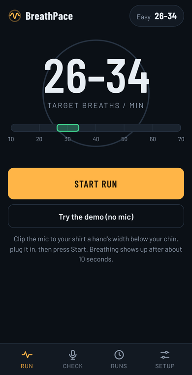
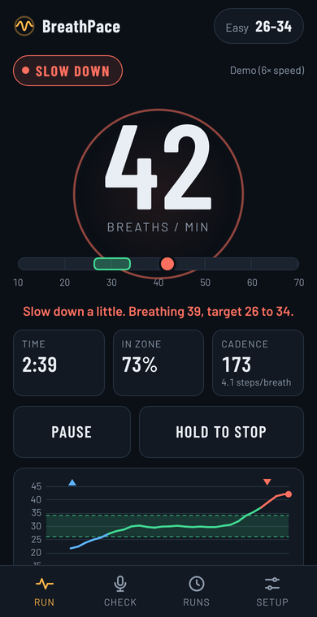
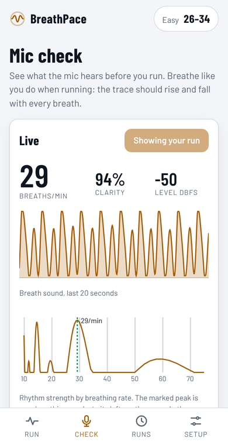

# BreathPace: a running coach that listens to your breathing

A phone app that hears your breathing through a **small clip-on microphone on
your chest**, works out how many breaths you take per minute, and **tells you
to slow down or speed up** so your effort stays in a target zone.

Breathe too fast for the zone and it says *"Slow down a little. Breathing 42,
target 26 to 34."* Drift below it and you hear *"You can speed up."* Get back
in and it says *"Good, that's your zone."* Falling tones mean slow down and
rising tones mean speed up, so it works without the voice too.

<p>
  
  
  
</p>

It's a web app (a PWA): it runs in the phone's browser, installs to the home
screen like a normal app, works offline once loaded, and **all audio stays on
the phone**. Nothing is uploaded anywhere.

```
chest mic ──▶ band filters ──▶ footstep-removing median ──▶ breath envelopes ──▶ rhythm finder ──▶ breaths/min
                   └────────▶ 40–150 Hz thumps ──────────▶ step rhythm ──────────────────────────▶ cadence
breaths/min ──▶ coach (zone, warm-up, delays, reminders) ──▶ voice + tones + vibration
```

## Why breathing?

Breathing rate tracks how hard you're working closely, and it reacts within a
few breaths when you speed up or slow down, much faster than heart rate.
Sports scientists have argued it's a better effort marker than the numbers
watches usually show (Nicolò, Massaroni & Passfield, *Respiratory Frequency
during Exercise: The Neglected Physiological Measure*, Frontiers in
Physiology 8:922, 2017, <https://doi.org/10.3389/fphys.2017.00922>).

## What you need

- **A phone**: Android with Chrome, or an iPhone with Safari.
- **A clip-on (lavalier) microphone** that plugs into the phone: USB-C,
  Lightning, or a 3.5 mm jack mic made for phones (a "TRRS" plug). A wireless
  lav kit whose receiver plugs into the phone works too.
- **Earbuds or headphones** are recommended so you hear the cues clearly.
  Bluetooth earbuds are fine for listening; just don't use their built-in mic
  as the breathing mic, because it's at your ear, not your chest.
- **An armband or running belt** that keeps the phone's screen on and
  reachable.
- Optional: a small foam windscreen on the mic, which helps a lot outdoors.

## 1. Put it on your phone

The microphone only works on a secure (`https://`) web page, so the app needs
to be hosted somewhere. The easiest place is GitHub Pages, straight from this
repository. A workflow for it is included
(`.github/workflows/breath-coach-pages.yml`).

1. On GitHub, open this repository's **Settings → Pages**, and under **Build
   and deployment → Source** choose **GitHub Actions**. You only do this once.
2. Merge this branch into the repository's default branch (for example by
   opening a pull request and merging it). That push starts the **Deploy
   BreathPace to GitHub Pages** workflow under the **Actions** tab. You can
   also run it by hand from there with **Run workflow**.
3. When it finishes, the app is at
   `https://willjrochester3333-cpu.github.io/RANDOM-PROJECTS/breath-coach/`.
   The workflow run shows the exact link.
4. Open that link on your phone, then install it:
   - **iPhone (Safari):** Share button → **Add to Home Screen**.
   - **Android (Chrome):** ⋮ menu → **Add to Home screen** or **Install app**.

Other options:

- **Any static host:** the whole app is the `app/` folder (plain HTML, CSS
  and JavaScript, with no build step). For example, drag the `app` folder onto
  [Netlify Drop](https://app.netlify.com/drop) to get an `https://` link.
- **On a computer** (useful with a USB mic for testing): run `npm run serve`
  and open <http://localhost:8080>. `localhost` counts as secure, so the mic
  works.

## 2. Before your first run (5 minutes)

1. **Clip the mic** to your shirt or collar about a hand's width below your
   chin, pointing up towards your mouth, and plug it in.
2. Open the **Check** tab and tap **Start listening**. Breathe like you do
   when running. The trace should rise and fall with every breath, and the big
   number should settle near your real breathing rate within about 10 seconds.
   **Clarity** above about 60% is good.
3. Run the **Breath sound test** on the same tab: follow the growing and
   shrinking circle for 45 seconds, breathing loudly through your mouth.
   BreathPace works out whether it hears one sound per breath or two (in and
   out), and sets itself up to count correctly.
4. Pick a **target zone** in **Setup** (or tap the zone button at the top).
5. Press **Test the cue** in Setup to check you can hear the voice.

## 3. Running with it

- Press **Start run**. The first reading arrives after about 10 seconds; until
  then the status says *Listening*.
- The big number is your breathing rate. The colour and status tell you what
  to do: **green / In zone**, **red / Slow down**, **blue / Speed up**.
- **Warm-up** (2 minutes by default): no "speed up" cues while your breathing
  is still ramping up. "Slow down" still works, in case you go off too fast.
- The coach waits until your breathing has been out of the zone for **10
  seconds** before saying anything, then reminds you every **45 seconds**. If
  you're already heading back towards the zone it gives you longer before
  nagging again.
- **Make this my zone:** after a few minutes at the effort you want, tap it.
  BreathPace sets the zone around your last minute of breathing (±8%).
- **Pocket lock** blacks out the screen except for the number, so pocket or
  arm bumps don't press anything. Hold the button to unlock.
- **Hold to stop** (about a second) ends the run, shows a summary, and saves
  it under **Runs**.
- The screen stays on during a run. Keep BreathPace open in front: phones can
  pause web apps that are hidden or behind a locked screen.

### Target zones

These are rough starting points for recreational runners. Breathing rates vary
a lot from person to person, so after one or two runs use **Make this my
zone**, or set your own numbers.

| Zone | Breaths / min | Feels like |
|------|---------------|------------|
| Recovery | 20–26 | Very easy; you could breathe through your nose |
| Easy | 26–34 | Conversational; most of your running |
| Steady | 32–40 | Comfortably hard; short sentences |
| Tempo | 38–46 | Hard but controlled; a few words at a time |
| Intervals | 44–54 | Very hard repeats |

### Settings worth knowing

| Setting | What it does |
|---------|--------------|
| Warm-up | Minutes at the start with no "speed up" cues |
| React after… | How long breathing must stay out of the zone before a cue |
| Remind me every | Gap between repeated cues while you stay out of the zone |
| Spoken status update | Optional "12 minutes. Breathing 31. In the zone." |
| Detailed / Short | Full sentences, or just "Slow down." |
| Breath sounds | *Automatic* for most people; *In and out sound the same* if the rate reads about double what you count (the breath sound test sets this for you) |
| Show cadence | Steps per minute and steps per breath, measured from footstrike thumps (beta) |

## 4. Check a recording

On the **Check** tab, **Analyse a recording** takes any audio file (WAV, M4A,
MP3…). Record a run with your phone's voice recorder and the clip-on mic,
load the file, and BreathPace shows your breathing rate over the whole run and
the exact moments the coach would have spoken. It's a good way to check your
mic setup, or to tune the zone, without running with the app.

**Save last 30 s as WAV** on the same tab saves what the mic just heard, which
helps if you want to compare mics or report a problem.

## How the breathing detection works

Hearing breathing on a runner's chest is harder than it sounds. The mic also
picks up footstrikes (loud thumps 2.5–3 times a second), clothing rustle,
wind, traffic and the cues themselves. Here's what each stage does, and why.
The code is in `app/js/dsp/`.

1. **Band split** (`frontend.js`). The audio is split into four bands
   (150–400 Hz, 0.4–1 kHz, 1–2.5 kHz, 2.5–5 kHz) with Butterworth filters.
   Breath sounds are noise-like and spread across these bands; footstrike
   thumps sit mostly lower.
2. **Footstep removal.** Each band's energy is measured every 5 ms, then
   passed through a ~95 ms running median. A footstrike lasts a few tens of
   milliseconds, so the median ignores it; a breath lasts several hundred
   milliseconds, so it survives.
3. **Envelopes** (`breath-detector.js`). Energies become decibels, so the mic's
   volume doesn't matter, and are low-passed at about 1.6 Hz. Breathing (up to
   ~75/min) passes; anything at step rate is suppressed. A fifth "tone"
   channel tracks high bands minus low bands, which tells hissy inhales apart
   from breathy exhales.
4. **Rhythm finder.** Once a second, each channel's last ~10 seconds is
   compared with delayed copies of itself (normalised cross-correlation, with
   each window detrended separately so breathing starting or stopping can't
   fake a rhythm). Channels are weighted by how rhythmic they are and summed.
5. **Choosing the rate.** A steady rhythm also lines up at 2×, 3×… its
   period, which would read as half or a third of your real rate. BreathPace
   takes the *shortest* period that is nearly as strong as the best one (the
   standard fix in pitch tracking), with hysteresis so it doesn't flip
   between choices.
6. **Confidence.** The rhythm has to show up in both halves of the window and
   agree with the previous reading. Otherwise there's no number, and after 20
   seconds without one the coach says it can't hear you.
7. **Inhale vs exhale.** If inhales and exhales sound alike, two bursts per
   breath look like breathing twice as fast. The automatic mode relies on
   them differing in loudness or tone; the *In and out sound the same* mode
   counts a burst pair as one breath when there's a burst halfway through the
   cycle.
8. **Cadence** (`cadence.js`). The energy the median removed is a clean
   "thump" signal. A separate 40–150 Hz band catches footstrikes even under
   loud breathing. Its rhythm gives steps per minute.

The coach (`app/js/coach/coach.js`) takes the median of the last 8 seconds of
readings, adds 1 breath/min of hysteresis at the zone edges, waits out the
delay, and then cues. Because cues played through the phone speaker can reach
the chest mic, readings from the 6 seconds after each cue are ignored.

## Testing

```bash
npm test
```

38 unit tests (under a minute) run the real detector on **synthetic** chest-mic
audio from `app/js/sim/breath-synth.js`. That audio has breath bursts with
breath-to-breath jitter, footstrike thumps with left/right differences,
background noise and wind. The tests cover 15–70 breaths/min, loud footsteps
at 150–190 steps/min, noise and wind, loud inhales, identical inhale and
exhale sounds, breathing locked to steps (2:2 and 3:3), silence and
noise-only input (which must produce no reading), breath holds, gradual
changes, 16 / 32 / 44.1 / 48 kHz audio, and mic gain from very quiet to near
clipping. The coach logic has its own tests: warm-up, delays, reminders,
hysteresis, lost signal and time in zone.

In a sweep of 72 randomised synthetic runs (1,656 readings), every reading was
within 6% of the true rate (worst 4.7%), and the first reading arrived after
9 seconds (at most 11).

```bash
npm i -D playwright && npx playwright install chromium   # once
npm run e2e
```

The end-to-end test (about 2 minutes) opens the app in real Chromium and
swaps the microphone for a synthetic breathing recording. It checks that the
mic opens through the AudioWorklet, that the app locks on at 30 breaths/min
and shows *In zone*, and that it says "slow down" when breathing rises to 46.
It also checks the cadence reading, hold-to-stop, saving to history, and
analysis of an uploaded file. `npm run make-test-audio` writes the same
recording to `breathing-test.wav` if you want to play with it.

## Limitations

- **It has only been tested on synthetic audio**, not yet on real runners
  with real mics. Expect to tune it. The Check tab's trace, rhythm chart and
  WAV export exist to make that easy. The numbers to adjust are at the top of
  `app/js/dsp/breath-detector.js` (`DETECTOR_DEFAULTS`) and
  `app/js/coach/coach.js` (`COACH_DEFAULTS`).
- **Keep the app open and the screen on.** Web apps can be paused when hidden
  or when the screen locks, especially on iPhone. BreathPace asks the phone to
  keep the screen awake during a run.
- **Strong wind** across the mic can drown out breathing. A foam windscreen
  helps, and so does clipping the mic where your body shields it.
- **Quiet nose breathing** at very easy paces may be too soft to hear. The
  app tells you when it can't hear you instead of guessing.
- Breathing rate is a guide to effort, not a measurement of fitness, and this
  is a training aid, not a medical device. Stop if you feel dizzy, faint or
  unwell.

## Project layout

```
running-breath-coach/
├── app/                      the web app: deploy this folder as-is
│   ├── index.html, styles.css, manifest.webmanifest, sw.js (offline cache)
│   ├── fonts/                Barlow + Barlow Condensed (SIL Open Font License)
│   ├── icons/
│   └── js/
│       ├── main.js           start-up and navigation
│       ├── engine.js         mic → detector → coach → voice; records the run
│       ├── analysis.js       analyse an uploaded recording
│       ├── audio/            mic capture (AudioWorklet), demo source, WAV
│       ├── dsp/              filters, front end, breath detector, cadence
│       ├── coach/            zone logic, phrases, speech/tones/vibration
│       ├── sim/              synthetic breathing generator (demo + tests)
│       ├── store/            settings and run history (on the phone)
│       └── ui/               the four screens and the charts
├── tests/                    unit tests (node --test) and e2e/ (Playwright)
├── tools/                    local server, test-audio and icon generators
└── docs/                     screenshots for this README
```
